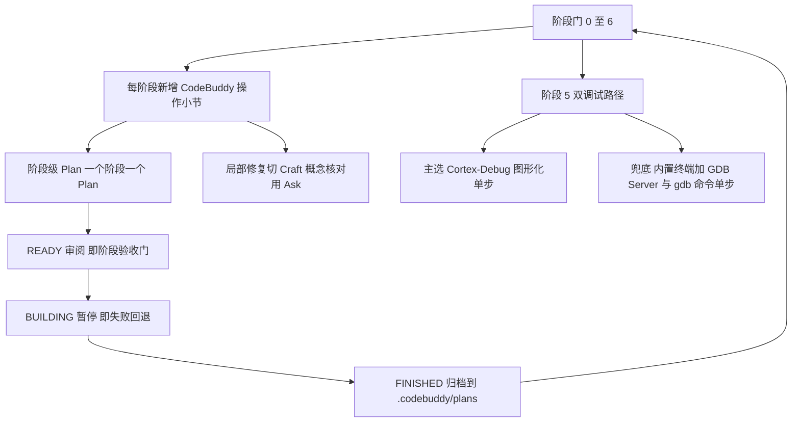

## 用户要求

用户希望整套 STM32 蜂鸣器 PWM 开发工作流在**用户实际使用的 AI 开发环境**中完成，而现有工作流方案描述的是另一套编辑器与调试前端，两者不一致，需要就地更新方案。本次只修订方案文档本身，不建立工程、不生成源码、不改动原理图。

## 产品概述

交付一份修订后的分阶段操作型工作流方案：保留原有的阶段门结构、每阶段六要素（输入、可直接复制的生成指令、产出物、验证点、验收标准、失败回退）、硬件引脚映射表作为唯一真相源，以及端到端验收闭环；把全文的编辑器与调试前端表述统一到用户所用环境，并为每个阶段补充"在该环境中用哪种交互方式、引用哪些上下文、点哪里、如何推进到下一步"的操作指引。单步调试同时给出图形化与纯命令两种落地方式，各自带可观测的验收标准与失败回退。

## 核心功能

- 就地全面修订方案，统一替换编辑器与调试前端相关表述，覆盖全部阶段与附录
- 每阶段新增操作指引：交互方式选择、上下文引用、界面入口动作、计划生命周期推进方式
- 单步调试双路径：图形化单步为主选、纯命令单步为兜底，两条路径均有前提、验收标准与回退
- 阶段级计划与阶段门一一对应：一个阶段一个计划，审阅环节即验收门，归档结果供下一阶段引用
- 保持硬件事实、蜂鸣器类型与 PWM 路径分支、串口电平陷阱、零手写代码约束、可观测验收标准不变
- 明确本次仅交付方案文档，不创建任何工程实体文件

## Tech Stack Selection

本任务为**工作流方案文档修订**（静态 Markdown），不搭建运行时工程、不引入新框架，因此无运行时技术栈变更。

方案所描述的目标工程栈严格沿用用户已确认的组合，保持不变：

- 固件：STM32 HAL + STM32CubeMX 初始化；定时器 PWM 驱动蜂鸣器；USART `printf` 重定向作 Debug 输出
- 构建：CMake + Ninja + `arm-none-eabi-gcc`，Debug 构建 `-O0 -g3`
- 调试硬件链路：J-Link SWD + J-Link GDB Server
- 运行平台：Windows + PowerShell，所有命令示例必须兼容

唯一变化在**编辑器与调试前端及其操作方式**：由 VS Code 改为 CodeBuddy IDE，涉及 `Ask` / `Craft` / `Plan` 三模式、Plan 五步生命周期与 `.codebuddy/plans/` 归档、`@` 上下文引用、内置终端、Skills / Rules / MCP、插件市场。调试前端采用双路径：Cortex-Debug 扩展（主选，`F5` 图形化单步、变量视图、SVD 外设寄存器视图）与 `JLinkGDBServerCL` + `arm-none-eabi-gdb` 命令行单步（兜底）。

## Implementation Approach

采用**分段定位后逐段替换**，而非全局字符串替换。已定位 27 处相关表述，分布在文首声明、阶段 0、2、3、4、5、6 与附录 A/B/C/E/G，且分别处在生成指令、校验命令、验收标准、故障回退等不同语境；简单替换会破坏语义，例如环境校验命令应改为"探测 CodeBuddy 环境可用性"而不是直接删除，调试配置产物仍需保留但必须标注为"后续执行工作流时才生成"。

关键决策与权衡：

1. **每阶段新增统一的「CodeBuddy 操作」小节**，固定四个字段：模式选择（阶段级用 Plan、局部修复切 Craft、概念核对用 Ask）、`@` 引用对象（工作流文档、`docs/hardware_pins.md`、`.codebuddy/plans/` 归档计划）、入口动作（侧栏 `Plan Mode` 新建计划、输入框左下 `Ask ▾` 切模式、`New Chat`、READY 审阅后点开始执行、内置终端跑 PowerShell）、可用扩展能力（pdf skill、Rules、MCP）。理由：用户的核心诉求是"在 CodeBuddy 中完成"，只改工具名无法让方案可执行，必须给出操作路径；统一字段便于逐阶段验收（DRY、可维护）。
2. **一个阶段一个 Plan** 写成显式规则。依据官方使用原则"单一 Plan 聚焦单一功能模块，功能模块完成后再开始下一个"，与方案的阶段门天然对应：`READY` 审阅 = 阶段验收门，`BUILDING` 暂停/微调 = 失败回退，`FINISHED` 归档 = 下一阶段上下文。这同时避免一个超大 Plan 导致命名与接口风格混乱。
3. **阶段 5 重写为双路径并列结构**：主选与兜底各自给出前提、配置产出、验证点、验收标准、失败回退，共用 CMake 构建与烧录脚本。由于 CodeBuddy 能否安装 Cortex-Debug 尚未实测，方案必须要求 AI 先探测实际环境再生成配置，禁止臆造配置路径与 J-Link 参数；主选失败时按明确规则切到兜底路径。理由：既保留图形化单步的用户体验，又保证零插件依赖下仍能完成"可单步"的硬性要求（可靠性、安全降级）。
4. **不变项冻结**：阶段 1 的硬件引脚映射表、1.2 人工复核清单、蜂鸣器有源/无源与 A/B/C PWM 路径、RS232 电平陷阱、SWD 引脚与跳线、零手写代码约束、可观测验收标准、PowerShell 兼容。理由：这些是已解析并复核过的硬件真相与用户原始约束，改动会引入回归。

性能与复杂度：静态文档无运行时开销；修订复杂度与文档长度线性相关（约 752 行）。主要风险是遗漏残留表述或误改硬件事实，用"扫描清单 → 分段修订 → 全文复核"三道关卡控制；不重复解析 PDF、不重新生成已确认的引脚映射，避免不必要开销。

## Implementation Notes

- 复用现有文档章节结构与已解析硬件事实；阶段 1 的 1.1 表、1.2 复核清单、附录 F 速查卡中的硬件数值一律不得改动。
- PowerShell 兼容：删除 `code --list-extensions` 校验，改为由 AI 生成 CodeBuddy 环境探测步骤；含空格或括号路径加引号；J-Link 参数先用 `--help` 探测再写，不凭记忆编造。
- 附录 E 与文首声明继续显式标注"所有工程文件路径均为后续执行工作流时才生成"；本次工作区除该 Markdown 外无新增文件，原理图 PDF 只读不修改。
- 验收标准保持可观测动作（命令输出、终端日志、断点命中、变量值、波形频率与占空比），禁止"配置正确"这类不可验证表述。
- 附录 A 通用模板、附录 B 32 项勾选表、附录 C 排查表、附录 D 回退话术、附录 E 产物清单、附录 G 术语同步更新；如确需保留 VS Code 作对比说明，必须显式标注为对比，不得作为唯一前端。
- Blast radius 控制：只改 1 个 Markdown 文件，不触碰 `.codebuddy/`、不创建 `launch.json`、`.c/.h`、`CMakeLists.txt`；Mermaid 阶段门图保留并标注模式映射。

## Architecture Design

文档内逻辑结构（同一文件内的组件关系）：文首交付范围声明 → 第 0 节使用说明（占位符表、阶段门图、新增模式与入口总览）→ 阶段 0 至阶段 6（每阶段原六要素 + 新增「CodeBuddy 操作」小节）→ 附录 A 至 G。阶段 5 内部再分主选与兜底两条并列路径，共用构建与烧录部分。



## Directory Structure

本次仅有 1 个文件被修改，原理图作为只读输入不改动；文档内提及的工程文件路径均为"后续执行工作流时的目标产物"，本次不创建。

```
c:/Users/HenrryBian/CodeBuddy/20261110233826/
├── STM32_Buzzer_PWM_Workflow.md             # [MODIFY] 本次唯一交付物。就地全面修订：更新文首交付范围声明、0.1 占位符表（新增模式与入口相关占位符）、0.2 阶段门图；把 27 处编辑器/调试前端表述统一改为 CodeBuddy IDE；阶段 0 的软件清单、生成指令、PowerShell 校验命令与验收标准改为 CodeBuddy 环境探测；阶段 2、3、4 的生成指令、输入上下文、验证点、验收标准、故障回退同步替换；阶段 5 重写为 Cortex-Debug 主选与命令行 GDB 兜底双路径，各带前提、配置产出、验证点、验收标准与失败回退；阶段 6 与附录 A-G 同步更新模板、勾选表、排查表、回退话术、产物清单、速查卡与术语。每阶段新增「CodeBuddy 操作」小节，固定模式、引用对象、入口动作、扩展能力四个字段。硬件引脚映射表、蜂鸣器类型与 PWM 路径分支、串口电平与 SWD 事实、零代码输入约束、可观测验收标准、PowerShell 兼容性保持不变。
└── 红牛开发板电路图(RedBull Schematic).pdf  # [现有/只读] 阶段 1 原理图输入，已解析完成。本次不做任何修改、不重复解析，仅作为方案引用的硬件真相来源。
```

## Agent Extensions

### SubAgent

- **code-explorer**
- Purpose: 以 very thorough 级别全面扫描 `STM32_Buzzer_PWM_Workflow.md`，定位全部编辑器/调试前端相关表述（含 VS Code、Cortex-Debug、`.vscode/`、`code --list-extensions`、`F5`、插件市场等直接与间接表述）以及每阶段六要素、附录章节边界。
- Expected outcome: 产出精确的「待改位置清单」与「必须保持不变的内容清单」（硬件事实、阶段门结构、PowerShell 命令、零代码约束），作为后续分段修订与最终全文复核的逐项依据，确保无遗漏、无误改。