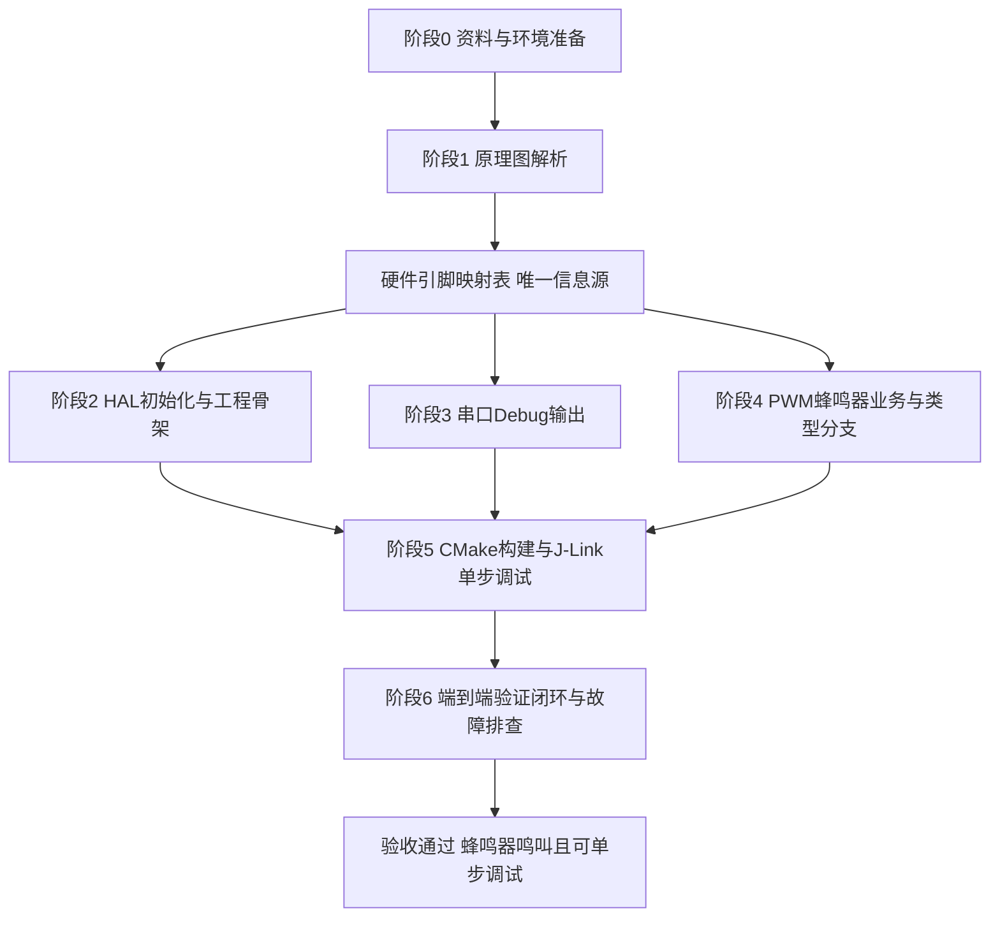

## 用户要求

用户拥有一块 STM32 开发板及配套原理图，希望得到一份详细、可以一步一步执行的工作流，用于完成"让蜂鸣器以 PWM 方式鸣叫"这一业务功能。整个过程用户不输入任何代码，全部交由 AI 生成；运行信息通过串口作为 Debug 输出口，并支持使用 J-Link 进行单步调试。本次仅需要工作流方案本身，不创建工程、不产出业务代码、不改动现有资料。

## 产品概述

交付一份分阶段的操作型工作流方案：把从"资料就位"到"蜂鸣器按预期鸣叫且可单步调试"的全过程拆成顺序阶段，每个阶段明确给出输入资料、可直接复制给 AI 的提示词、AI 应交付的产出物、验证点、验收标准以及失败时的回退办法。用户按阶段逐步把提示词交给 AI、逐项验收即可推进，全程零代码输入。方案以一份"硬件引脚映射表"作为承上启下的中间产物，使原理图信息一次确认、后续各阶段共同引用。

## 核心特性

- 阶段化、一步一步的流程，每阶段设验收门，通过后才进入下一阶段
- 每阶段六要素齐全：输入、AI 提示词、产出物、验证点、验收标准、失败回退
- 原理图解析与人工复核清单，形成引脚映射表作为唯一硬件信息源
- 区分蜂鸣器类型的鸣叫策略，避免生成与实际硬件不符的业务行为
- 串口 Debug 输出与单步调试路径贯穿全程，可观察、可断点、可核对
- 端到端验证闭环与常见故障排查表
- 明确标注本次仅交付方案文档，不建立工程、不生成源码

## Tech Stack Selection

本任务为**工作流方案文档**交付（元工作流 / workflow specification），不搭建工程、不编写固件源码。方案所描述的目标工程栈严格沿用用户已选定的组合，不引入新框架：

- 编辑器与调试：VS Code + Cortex-Debug 插件 + SEGGER J-Link GDB Server（SWD 接口）
- 固件与初始化：STM32 HAL + STM32CubeMX 生成的初始化配置
- 构建：CMake + Ninja + arm-none-eabi-gcc 交叉工具链，启动文件与链接脚本由 AI 生成
- Debug 输出：USART + `printf` 重定向（`__io_putchar` / `_write` + `HAL_UART_Transmit`，阻塞式优先，便于单步观察）
- 业务功能：定时器 PWM 通道驱动蜂鸣器，非阻塞鸣叫状态机
- 运行平台：Windows（win32）+ PowerShell，命令示例必须兼容 PowerShell
- 本次交付物技术形态：单一 Markdown 方案文档

工作区已确认存在 `红牛开发板电路图(RedBull Schematic).pdf`（约 112 KB），为阶段 1 的真实输入；当前无工程源码、无 git 仓库。

## Implementation Approach

采用**阶段门（stage-gate）**结构组织方案：资料准备 → 原理图解析 → 引脚映射 → 初始化与骨架 → 串口 Debug → PWM 业务 → 构建与调试配置 → 端到端验证，共 8 个顺序阶段。每阶段统一"六要素"模板，提示词采用"角色 + 输入上下文 + 硬约束 + 期望产出文件清单 + 验收命令"结构，保证用户复制即可让 AI 产出代码、自身零输入。

关键决策与权衡：

1. **引脚映射表作为唯一硬件真相源**。所有后续提示词引用该表字段而非硬编码 `TIMx_CHy` / `USARTx` / 型号。理由：原理图是 PDF，信息需人工复核且可能不完整；解耦后换板或改引脚只需更新一处，并从根本上防止 AI 臆造引脚（DRY、可靠性、可扩展）。表字段至少包含：MCU 型号与封装、时钟源与频率、蜂鸣器 GPIO 与定时器通道、蜂鸣器类型与有效电平、Debug 串口与 TX/RX、SWD 引脚、每项证据页码与置信度、待人工确认项。
2. **蜂鸣器类型分支**。有源蜂鸣器 PWM 只能做开关与占空比控制、无法变频改变音调；无源蜂鸣器才能通过改 ARR/PSC 变频鸣叫。方案给出电路判定依据与两套独立提示词，避免生成错误业务代码。
3. **非阻塞鸣叫状态机**，基于 `HAL_GetTick()` 管理鸣叫时长、间歇与频率序列，替代 `HAL_Delay`，避免阻塞串口日志与调试观察。
4. **可调试性优先**：明确禁止把 SWD 引脚复用为 GPIO、禁止关闭调试口；约定 `-O0 -g3` 便于断点与变量观察；SWD 器件名、SVD 文件路径在提示词中参数化。
5. **零代码约束**：提示词中不得要求用户手写代码，禁止 AI 编造不存在的 HAL API，不确定处描述意图而非伪造签名。

性能与复杂度：方案文档为静态内容，无运行时开销。方案对被生成工程的性能约束为：PWM 状态机每 tick O(1)、无动态分配；串口日志低频且带等级、禁止在中断中 `printf`、禁止高频刷屏影响单步观察。避免技术债：完全沿用官方 HAL + CubeMX 惯例，不引入自研封装；严格遵守范围，不建工程实体文件。

## Implementation Notes

- 复用已存在的 `红牛开发板电路图(RedBull Schematic).pdf` 作为阶段 1 输入，使用 [skill:pdf] 解析；若文字层缺失则写明 OCR / 扫描页图片识别的回退路径，不得臆造型号与引脚。
- 所有命令兼容 PowerShell：避免 bash 专属语法，含空格路径加引号，工具链可用性用 `--version` 类命令校验。
- 提示词统一采用占位符约定（`{MCU}`、`{BUZZER_TIM_CH}`、`{DEBUG_USART}` 等），并在附录给出"如何用本方案"与"通用提示词模板"。
- 日志约定：低频、带等级、不含敏感信息，避免刷屏导致断点调试时信息不可读。
- **Blast radius 控制**：本次仅新增 1 个 Markdown 方案文档；不创建 `CMakeLists.txt`、`.ioc`、`launch.json`、`.c/.h` 等任何工程实体；现有 PDF 只读不修改。方案文档内部描述的目标产物路径须显式标注为"后续执行工作流时才生成"，避免读者误认为本次已建工程。
- 验收标准必须是可观测动作（命令输出、终端日志、断点命中、变量值、波形频率与占空比），禁止"配置正确"这类不可验证表述。

## Architecture Design

阶段门数据流与依赖关系：原理图 → 引脚映射表（唯一耦合点）→ AI 生成初始化/串口/PWM → 构建 → J-Link 调试 → 验证闭环；每阶段验收门控制是否推进。



方案文档章节结构（同一文件内的逻辑组件）：如何使用本文档与占位符约定 → 阶段 0 环境准备与 PowerShell 校验清单 → 阶段 1 原理图解析与引脚映射表模板/人工复核清单 → 阶段 2 初始化与工程骨架 → 阶段 3 串口 Debug → 阶段 4 PWM 业务（含有源/无源双分支）→ 阶段 5 构建与 J-Link 单步调试配置 → 阶段 6 验证闭环 → 附录（通用提示词模板、逐项验收勾选表、故障排查表、失败回退矩阵）。

## Directory Structure

本次仅新增一份方案文档；现有原理图作为只读输入。文档内提及的工程文件路径均为"后续执行工作流时的目标产物"，本次不创建。

```
c:/Users/HenrryBian/CodeBuddy/20261110233826/
├── 红牛开发板电路图(RedBull Schematic).pdf   # [现有/只读] 阶段 1 的原理图输入，不做任何修改。方案需写明按 PDF/扫描图片类型分别用 [skill:pdf] 或 OCR/图像识别读取，并列出 MCU 型号、蜂鸣器驱动电路、Debug 串口、SWD 引脚的抽取位置与人工复核项。
└── STM32_Buzzer_PWM_Workflow.md              # [NEW] 本次唯一交付物：分阶段全 AI 生成工作流方案。逐阶段给出输入、可直接复制的 AI 提示词、AI 产出物清单、验证点、验收标准、失败回退；内嵌引脚映射表模板、六要素/通用提示词模板、Mermaid 阶段图、PowerShell 环境校验命令、逐项验收勾选表与故障排查表。须显式声明"本方案不建工程、不生成源码"，且所有代码生成提示词引用引脚映射表占位符而非硬编码引脚。
```

## Agent Extensions

### Skill

- **pdf**
- Purpose: 解析工作区中真实存在的 `红牛开发板电路图(RedBull Schematic).pdf`，抽取 MCU 型号与封装、时钟源、蜂鸣器 GPIO/定时器通道与类型、有效电平、Debug 串口 TX/RX、SWD 引脚及证据页码。
- Expected outcome: 产出可复核的硬件事实清单，据此填充方案阶段 1 的"引脚映射表模板"示例字段与抽取提示词，使整份工作流贴合真实开发板、不臆造引脚，并明确 PDF 文字层缺失时的 OCR 回退路径。