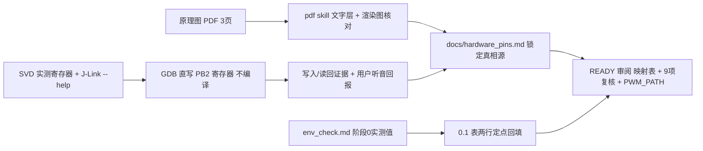

## 用户要求

按工作流**阶段 1**解析《红牛开发板电路图(RedBull Schematic).pdf》，产出并锁定一份「硬件引脚映射表」。核心约束：严格区分「图纸文字明确写出的事实」与「由电路推断的结论」，逐项标注置信度（高/中/低）与证据页码（P1/P2/P3）；严禁臆造型号、引脚号、定时器通道，无法从图纸确认的项一律写「待人工确认」并给出实测判定方法；表格化且字段名固定，便于后续阶段直接引用。

补充要求：

- 通过调试器直接读写芯片寄存器完成 PB2 蜂鸣器实测（有源/无源、有效电平），**全程不编译工程、不生成任何固件或构建产物**；实测结论以可观测证据为准。
- 顺手把阶段 0 已实测到的 SVD 文件与调试扩展可用性两项结论，**仅**回填到 0.1 占位符表对应两行。
- 交付目标为 **READY 审阅**，审阅物为「映射表 + 9 项复核 + {PWM_PATH}」；`{PWM_PATH}` 默认写入路径 A 作为推荐值，READY 审阅时可改选 B/C。

## 产品概述

交付一份锁定版「硬件引脚映射表」文档：以固定字段名的表格承载全部硬件字段，另附事实/推断分栏、证据页码与置信度标注、9 项人工复核清单（看哪里、怎么量、预期结果）、PWM 实现路径决策结论，以及一份寄存器实测记录（写入值、读回值、判据与结论）。文档一旦落盘即成为唯一硬件真相源，后续阶段通过引用使用，不再重复猜测引脚。另交付对 0.1 占位符表的两行定点回填。最终汇总成可勾选的 READY 审阅清单与验收门。

## 核心功能

- 映射表覆盖：MCU 型号/封装/内核/存储、HSE/LSE 晶振、蜂鸣器网络与驱动电路、GPIO 与物理引脚号、TIM 复用能力、可用硬件 PWM 扩展口、Debug 串口与电平、SWD/JTAG 引脚与连接器、BOOT/使能跳线与复位电路。
- 事实与推断分栏，逐项证据页码 + 置信度；图纸无法确认的字段写「待人工确认」并附实测判定方法。
- 9 项人工复核清单逐项落地：实测项给结论，目视/丝印/万用表类项不臆造、保留判定方法。
- PB2 寄存器实测：给出有源/无源与有效电平结论，附可观测证据与人工回报边界。
- `{PWM_PATH}` 决策门：A 为推荐值并说明 B/C 的改硬件代价与「有源蜂鸣器不能变频」语义约束。
- 0.1 表仅两行定点回填；验收门核验 0 臆造、无编译产物、三关键字段可复述。

## Tech Stack Selection

- **交付物类型**：Markdown 文档（`docs/hardware_pins.md` 新建 1 份；`STM32_Buzzer_PWM_Workflow.md` 定点修改 0.1 表 2 行）+ 会话内只读/探测命令。**不产生任何 `.c/.h/.s/.ld`、`CMakeLists.txt`、`.ioc`、`.elf/.hex/.bin`、调试配置或编译产物**。
- **平台与命令**：Windows + PowerShell；含空格或括号的路径一律加引号。
- **原理图解析**：使用 `[skill:pdf]` 抽取文字层并把 P1/P2/P3 渲染成图片做视觉核对；回退路径为 OCR/视觉识别 → 万用表通断档实测（人工）。
- **实测链路**：`JLinkGDBServerCL.exe` + `arm-none-eabi-gdb` 经 SWD 直接读写内存映射寄存器（沿用阶段 5 命令行兜底思路）；寄存器地址与位定义以工作区外实测 `STM32F103xx.svd` 为准，不凭记忆。
- **事实来源**：`STM32_Buzzer_PWM_Workflow.md`（阶段 1 六要素、1.1 基线、1.2 九项、1.3 决策门、阶段 5 559/557 行硬约束）、`docs/env_check.md`（8.3/8.4 实测值）、阶段 0 归档计划、原理图 PDF、SVD 文件。
- **流程**：CodeBuddy IDE `Plan` 模式，一个阶段一个 Plan，READY 审阅即阶段验收门；不引入新框架、配置格式或第三方依赖。

## Implementation Approach

**策略**：三条互不阻塞的链路（PDF 解析链路 / 寄存器实测链路 / 环境实测值回填链路）汇聚到一份锁定版真相源文档，最后以 READY 审阅物收口。全程不触碰编译器与构建系统。

**关键决策与取舍**：

1. **以 1.1 基线为核对起点，而非把 1.1 当结论**：工作流 225–247 行已记录本机真实解析结果。本次用 `pdf` skill 的文字层 + 渲染图逐字段复核，只修正证据不足或需降级的项，既避免从零重复解析，又满足「证据来自 PDF」的硬约束。
2. **用调试器直写内存映射寄存器替代「最小 GPIO 测试程序」**：SWD 的 AHB-AP 可在内核 `halt` 状态下直接读写外设寄存器，因此无需任何固件即可令 PB2 输出高/低电平。这是同时满足「不编译工程」与阶段 1 验收门（第 5、6 项须有实测结论）的唯一自洽方案，覆盖工作流 281 行失败回退中的旧写法。
3. **寄存器地址与 J-Link 参数一律不臆造**：地址/位定义从实测 SVD 读取（下表已核对）；`JLinkGDBServerCL.exe` 参数须先 `--help` 探测（阶段 0 明确未执行，工作流 559 行硬约束），不凭记忆写 `-device/-if/-speed/-port`。
4. **听觉判断由用户回报，不由 AI 断言**：AI 只能产出寄存器写入值与 `x/` 读回值这类可观测证据；「持续鸣叫 / 仅一声嗒」必须由用户回传。无回传则该项标「待人工确认」，绝不臆造结论。
5. **硬约束 2 优先于验收门「9 项全部有实际结论」**：#1–#4、#8–#9 属目视/丝印/万用表类，AI 无法观察实物，统一写「待人工确认 + 看哪里/怎么量/预期结果」；#7 由图纸 RS232 事实 + 用户接线回传构成结论；#5/#6 由寄存器实测 + 用户听音回报构成结论。
6. **`{PWM_PATH}` 默认 A、READY 可改选**：A 不改硬件且对有源/无源均适用；B 需飞线、C 需焊接换件。决策结论写入映射表，并保留「有源蜂鸣器不能变频改变音调」的语义约束（工作流 273 行）。
7. **回填范围严格收敛**：0.1 表只改 `{SVD}` 与 `{CB_EXT_AVAILABLE}` 两行；PB2 实测结论只写入 `docs/hardware_pins.md`，不回写 0.1 表（用户已确认）。

**性能与可靠性**：PDF 为一次性 3 页线性扫描，仅对存疑页渲染图片；SVD 只读取 RCC/GPIOB 两个 peripheral 片段，不做全文件解析；GDB 侧为常量次寄存器写 + 每步读回校验，属 O(1)。瓶颈在 J-Link 连接与用户听音回报的人工往返，采用「一次连接、批量写入、逐项读回、集中回报」减少往返次数。

**避免技术债**：复用 1.1/1.2/1.3 既有表格结构与占位符字段名、阶段 0 实测绝对路径与硬件禁忌清单；实测记录作为 `docs/hardware_pins.md` 的附录章节，不新增脚本或配置文件。

## Implementation Notes

**SVD 实测寄存器依据**（读取 `C:\Users\HenrryBian\AppData\Local\Programs\EmbeddedTools\Keil.STM32F1xx_DFP.2.4.1\SVD\STM32F103xx.svd` 所得，禁止凭记忆改）：

| 用途 | 地址 / 位定义 | SVD 依据 |
| --- | --- | --- |
| RCC 基址 | `0x40021000` | 1589 行 |
| `RCC_APB2ENR` | `0x40021018`，`IOPBEN` = bit3（开 GPIOB 时钟，最易漏） | 2243 / 2264 行 |
| GPIOB 基址 | `0x40010C00`（`derivedFrom="GPIOA"`） | 3540 行 |
| `GPIOB_CRL` | `0x40010C00`，PB2 的 `MODE2/CNF2` 位区 | 2667 行起字段区 |
| `GPIOB_ODR` | `0x40010C0C` | 3007 行 |
| `GPIOB_BSRR` | `0x40010C10`，`BS2` = bit2（置高） | 3115 行 |
| `GPIOB_BRR` | `0x40010C14`，`BR2` = bit2（置低） | 3319 行 |


`MODE2/CNF2` 的精确 `bitOffset` 执行时须从 SVD 的 CRL 字段区逐项读出再计算推挽输出配置值，不按记忆填数；`GPIOB_CRL` 采用「读—改—写」避免破坏其他引脚配置。

**GDB 会话要点**：先跑 `--help` 探测 J-Link 参数并用绝对路径启动 GDB Server；`arm-none-eabi-gdb` 仅 `target remote` 连接，**不 `file`、不 `load` 任何 elf**（这正是「不编译工程」的核心）；`set mem inaccessible-by-default off` 后方可写内存映射寄存器；`monitor halt` 停内核，防止 Flash 内既有固件回写 GPIOB 配置；顺序为「开 GPIOB 时钟 → 配 PB2 推挽输出 → BSRR 置 1 持续观察 → BRR 置 0 对照 → 每步 `x/1xw` 读回验证」；收尾置 PB2=0 静音并断开，不烧录、不改 option bytes、不启用读保护。

**硬件前置与禁忌**（沿用阶段 0 归档计划 87–88 行与 `docs/env_check.md` 第 5 节）：`JP5 BEEP` 短接、`JP8 BOOT0=0`、`JP6 JTAG_SEL` 为 SWD 可用模式、`J5` pin1 `Vref`=3V3 且偶数脚 GND 共地、板卡上电、禁止带电插拔；写 GPIO 前须确认 `JP9 BOOT1` 未把 PB2 强拉到固定电平（`R25 10K` 为弱驱动，推挽可覆盖但必须目视确认）；5V 仅供蜂鸣器；`CON1/CON2` 为 RS232 电平不可直连 USB-TTL。

**日志与证据**：GDB 终端逐步输出（写入值 + 读回值）整段保留到 `docs/hardware_pins.md` 附录，用户听音回报原文一并记录；不打印 SVD 全文、不含敏感信息；连接失败只记退出码与首行错误文本，不盲目重试。

**影响面控制**：不调用 cmake/ninja/arm-none-eabi-gcc，不改 PATH 或工具链状态，不新增脚本文件；0.1 表两行之外一律不动；`docs/hardware_pins.md` 落盘即锁定；不进入阶段 2。

**验收门与失败回退**：PDF 文字层缺失 → 渲染 PNG → OCR/视觉 → 万用表通断档；J-Link 连不上 → 按「跳线 → Vref → SWD 是否被复用 → BOOT0」决策树排查；寄存器读回不符 → 查 GPIOB 时钟门控与 `JP9` 强拉；听音无结论 → 标「待人工确认」且不得进入阶段 4；板卡版本不符 → 冻结推断项、仅保留实测项、重写映射表。

## Architecture Design

沿用文档既有线性「阶段门」结构，不引入新模式：

- **资料层（只读）**：原理图 PDF、工作流文档（阶段 1/阶段 5）、`docs/env_check.md`、阶段 0 归档计划、SVD 文件。
- **解析链路**：`[skill:pdf]` 文字层 + 渲染图 → 字段证据、事实/推断分类、置信度。
- **实测链路**：J-Link GDB Server + `arm-none-eabi-gdb`（SWD、halt 后直写寄存器）→ 可观测写入/读回证据 + 用户听音回报。
- **交付层**：`docs/hardware_pins.md`（唯一硬件真相源，锁定）+ 0.1 表两行回填。
- **判定层**：READY 审阅「映射表 + 9 项复核 + `{PWM_PATH}`」= 阶段 1 验收门。



## Directory Structure

```
c:/Users/HenrryBian/CodeBuddy/20261110233826/
├── docs/
│   └── hardware_pins.md                          # [NEW] 阶段 1 唯一交付物。包含：①固定字段名映射表（MCU/封装/内核/Flash/SRAM、HSE/LSE、蜂鸣器网络与驱动链、GPIO 与物理引脚号、有效电平、有源无源判据、TIM 复用能力、可用硬件 PWM 扩展口、Debug 串口与电平芯片/连接器、SWD/JTAG 引脚与连接器针数、BOOT/使能跳线、复位电路）；②每项「图纸事实/电路推断」分类 + 证据页码 P1/P2/P3 + 置信度；③图纸无法确认项（如三极管具体型号、Flash/SRAM 数值）写「待人工确认」并给实测判定方法；④9 项人工复核清单（看哪里/怎么量/预期结果/当前结论）；⑤{PWM_PATH}=A 决策结论与 B/C 代价；⑥附录：GDB 寄存器实测命令序列、SVD 寄存器地址表、写入值与读回值、用户听音回报原文。落盘即锁定，后续阶段由 @ 引用
├── STM32_Buzzer_PWM_Workflow.md                  # [MODIFY] 仅 0.1 占位符表两行定点回填：第 41 行 {SVD} 改为实测绝对路径 `C:\Users\HenrryBian\AppData\Local\Programs\EmbeddedTools\Keil.STM32F1xx_DFP.2.4.1\SVD\STM32F103xx.svd`（867312 字节，文件名与旧值 STM32F103.svd 不同）；第 47 行 {CB_EXT_AVAILABLE} 改为「已安装 marus25.cortex-debug 1.13.0-pre6 + 4/4 依赖 → 阶段 5 走图形化主选」。其余行（含 {BUZZER_ACTIVE_LEVEL}、{BUZZER_TYPE}、{PWM_PATH}）一律不动，不改阶段 1 正文与阶段 5 约束
├── 红牛开发板电路图(RedBull Schematic).pdf       # [只读引用] 3 页矢量 PDF，114821 字节；用 [skill:pdf] 抽文字层 + 渲染图核对；不改文件
├── docs/env_check.md                             # [只读引用] 2.3 / 8.3 / 8.4 节提供 SVD、Cortex-Debug、J-Link、GDB 实测绝对路径与硬件禁忌；不改文件
├── scripts/env_check.ps1                         # [只读，不改] 阶段 0 一键校验脚本，本次不调用
└── .codebuddy/plans/阶段0-资料与环境准备-环境校验与就绪判定_26b1905e.md  # [只读引用] 阶段 0 边界与硬件禁忌；本次两行回填是用户显式授权的唯一例外
```

工作区外只读引用：`C:\Program Files\SEGGER\JLink_V818\JLinkGDBServerCL.exe`、`C:\Program Files (x86)\Arm GNU Toolchain arm-none-eabi\14.2 rel1\bin\arm-none-eabi-gdb.exe`、上述 `STM32F103xx.svd`。

## Agent Extensions

### Skill

- **pdf**
- Purpose：抽取《红牛开发板电路图(RedBull Schematic).pdf》P1/P2/P3 的文字层，并把存疑页渲染成图片做视觉核对；支撑「图纸事实 / 电路推断」分类与证据页码标注。
- Expected outcome：得到逐页可定位的图纸文字证据与渲染图，使映射表每个字段都能落到 P1/P2/P3 与置信度；文字层缺失时给出渲染图作为 OCR/人工复核的输入，不产生猜测。