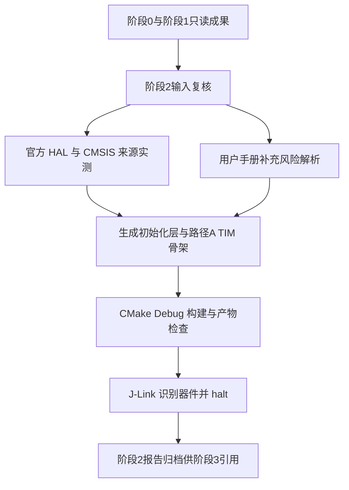

## 用户要求

用户要求基于最新版 `STM32_Buzzer_PWM_Workflow.md`，准备并开启阶段 2 的任务。阶段 2 需要承接阶段 0 与阶段 1 已锁定的成果，补齐阶段 2 开工前的必需依赖，完成该阶段的全部产出，并通过构建与连接验证。用户已明确选择：由 AI 先实测探测再获取官方依赖；本次不再停留在方案层，而要完整生成阶段 2 产出并跑通编译；PWM 实现路径维持阶段 1 锁定的路径 A。

## 产品概述

交付一套可执行的阶段 2 实施计划与执行结果：先复核输入与工作区基线、解决唯一硬阻塞、补充可选硬件风险说明，再生成初始化与构建骨架，完成 Debug 构建、产物检查、体积检查和 J-Link 识别验证，最后形成阶段报告与阶段 3 交接记录。整个过程保持用户零手写代码、所有代码与配置均由 AI 生成，且不提前实现后续阶段业务。

## 核心特性

- 承接阶段 0 与阶段 1 的锁定事实，不重复解析已锁定硬件信息
- 实测探测并获取阶段 2 必需的官方依赖，记录来源、版本、路径与校验证据
- 生成完整初始化层、启动与链接配置、构建配置以及路径 A 所需的基础定时中断骨架
- 跑通 Debug 构建，生成并检查全部目标产物，输出体积与构建证据
- 只做 J-Link 识别与 halt 验证，不烧录、不改跳线、不升级调试器固件
- 形成阶段 2 报告、自检清单、风险清单与阶段 3 交接记录
- 保持零代码输入、可观测验收标准、PowerShell 兼容与调试口可用

## Tech Stack Selection

本任务为嵌入式工程阶段 2 实施，严格沿用现有项目与用户已确认的组合，不引入新框架：

- 开发前端：CodeBuddy IDE，使用 `Plan` / `Craft` / `Ask` 模式、`@` 上下文引用、内置终端、检查点与归档计划
- 目标芯片：`STM32F103ZET6`，LQFP144，`Cortex-M3`，HSE 8 MHz，目标 SYSCLK 72 MHz
- 固件基础：ST 官方 STM32CubeF1 HAL 与 CMSIS 设备头，不安装 STM32CubeMX，不使用 StdPeriph 库替代 Cube HAL
- 构建工具：Windows + PowerShell，CMake 4.5.0-rc3，Ninja，`arm-none-eabi-gcc` / `arm-none-eabi-gdb` / `arm-none-eabi-size` 2.43.1
- 调试链路：J-Link SWD，`JLinkGDBServerCL.exe`，阶段 5 主选 `Cortex-Debug 1.13.0-pre6`，命令行 GDB 保留为兜底
- 只读输入：`STM32_Buzzer_PWM_Workflow.md`、`docs/env_check.md`、`docs/hardware_pins.md`、`红牛开发板电路图(RedBull Schematic).pdf`、`红牛开发板用户手册(RedBull Manual).pdf`

## Implementation Approach

采用「阶段门 + 先解阻塞 + 再生成 + 后验证」策略：先用只读探索复核阶段 2 输入、工作区基线与冻结事实，再实测探测本机可用资源并从 ST 官方 STM32CubeF1 或 CMSIS 渠道取得 HAL 源，随后按工作流阶段 2 提示词生成完整工程骨架并跑通编译，最后用 J-Link 仅做识别与 halt 验证并归档供阶段 3 引用。该方式把唯一硬阻塞前置，避免在 HAL 源缺失时生成无法编译的工程；同时保持阶段 0、阶段 1 的锁定结论为唯一输入，降低返工与臆造风险。

关键技术决策与理由：

1. **HAL 来源先探测再决定**：用户明确要求不装 CubeMX、全程命令行，且 `docs/env_check.md` 要求来源与路径必须实测、禁止凭记忆写。执行时先检查本机已下载包、Keil Pack、缓存、网络可达性与官方包文件树，再记录实际来源、版本、哈希与复制清单。这样既满足可验证性，也避免把 StdPeriph 误当 Cube HAL。
2. **只复制最小必需 HAL 源集合**：按阶段 2 初始化、GPIO、USART1、RCC、TIM 基础配置所需，结合官方包真实文件清单选取 `stm32f1xx_hal.c`、RCC、GPIO、UART、TIM、CORTEX 等相关源与头，写入 CMake 源列表。避免整包全量编译带来的构建时间和维护噪声，也避免缺文件导致链接失败。
3. **路径 A 只做基础准备**：阶段 1 已锁定 `{PWM_PATH}=A`，且 PB2 无 TIM 通道、蜂鸣器为有源、高电平有效。阶段 2 只保证 TIM 时钟、更新中断向量与中断服务函数占位可用，不实现蜂鸣器翻转、鸣叫序列或变频逻辑，防止越界到阶段 4。
4. **Debug 可观测优先**：Debug 构建使用 `-O0 -g3`，保留符号，Clock 配置后使 `SystemCoreClock` 可通过调试变量或后续日志验证；本阶段不生成调试前端配置，不创建 `.vscode/` 或 `launch.json`。
5. **CMake 4.x 兼容处理**：本机 CMake 为 4.5.0-rc3 预发布版，`CMakeLists.txt` 必须使用兼容的 `cmake_minimum_required` 声明，并在验收时用实际 `cmake --version` 复核，避免最低版本策略导致配置失败。
6. **边界控制**：不烧录固件、不改跳线、不改驱动、不升级 J-Link FW、不终止已有 J-Link 进程；JFlash 或 Commander 占用句柄时只记录风险，必要时由用户人工关闭后再做连接验证。

性能与可靠性：阶段 2 无业务数据处理，重点是构建可靠性。使用 Ninja 增量构建；HAL 源集合最小化，降低编译时间；启动文件与链接脚本按 `STM32F103ZETx` 容量配置；TIM 更新中断处理保持 O(1)，禁止 `printf`、动态分配与阻塞操作；构建日志与 J-Link 日志只记录命令、版本、首行错误、`size` 输出与 halt 结果，避免日志刷屏或输出大段二进制内容。避免技术债：完全复用官方 HAL/CMSIS 惯例与阶段 2 提示词，不新增自研抽象层，不重复解析原理图，不修改锁定版 `docs/hardware_pins.md`。

## Implementation Notes

- 只读复核必须覆盖 `STM32_Buzzer_PWM_Workflow.md` 阶段 2 章节、`docs/env_check.md` 第 339 行及第 10 节、`docs/hardware_pins.md` 锁定表与 READY 结论、`.codebuddy/plans/` 中阶段 0 与阶段 1 归档计划、工作区现有目录结构。
- HAL 源获取前先输出探测命令与探测结果，记录官方包来源、版本、绝对路径、文件哈希、精确复制文件清单；`docs/stage2_hal_source.md` 是该决策的唯一证据文件，不得只写「已下载」。
- 用户手册解析只补充 `JP5` / `JP6` / `JP8` / `JP9`、`BOOT0`、板卡版本、器件型号等仍待人工确认项；不改写 `docs/hardware_pins.md` 的锁定结论，不把手册推断覆盖实测结论。
- 所有 PowerShell 命令含空格或括号路径必须加引号；工具使用 `docs/env_check.md` 中实测绝对路径，或在当前会话临时设置 `$env:PATH`；J-Link 参数先用 `--help` 实测，不凭记忆写。
- 日志约定：构建日志保留命令、版本、错误首行、`size` 输出；J-Link 日志保留设备识别、内核 halt 与退出状态；不记录敏感信息，不 dump 大段 payload。
- Blast radius 控制：不修改 `STM32_Buzzer_PWM_Workflow.md`、`docs/env_check.md`、`docs/hardware_pins.md`、`scripts/env_check.ps1`、两个 PDF 与 `RedbullDemo.code-workspace`；不创建 `launch.json`、`.vscode/`、调试前端配置或阶段 3、阶段 4 业务代码；`.codebuddy/plans/` 由 Plan 生命周期自动归档，不用文件工具改写。
- 阶段 2 明确遗留：`pc=0x1FFFF3B6` 提示 `JP8 BOOT0` 可能非 0，需在阶段 5 前人工复核；J-Link 为 V8 兼容或克隆类，FW 升级暂缓，旧设备升级授权不沿用；串口实际接线方式仍待用户回传。

## Architecture Design

阶段 2 的输入与产物关系如下：阶段 0 提供工具链与环境证据，阶段 1 提供锁定硬件真相源，工作流阶段 2 提供生成指令和验收门；HAL 与 CMSIS 官方依赖作为工程源输入；生成结果经 CMake 构建形成 `.elf` / `.hex` / `.bin`，再由 J-Link 只做 halt 验证；最终报告归档供阶段 3 引用。



## Directory Structure

本次会首次创建工程实体文件。现有方案文档、阶段 0 与阶段 1 记录、PDF 与工作区文件均为只读输入；不修改锁定版硬件映射表，不修改工作流方案。

```
c:/Users/HenrryBian/CodeBuddy/20261110233826/
├── STM32_Buzzer_PWM_Workflow.md              # [现有/只读] 阶段 2 指令、六要素、验收门与 CodeBuddy 操作方式的来源，不修改。
├── docs/
│   ├── env_check.md                          # [现有/只读] 阶段 0 环境证据、工具绝对路径、CMake 版本提示、HAL 源缺口与 J-Link 风险，不修改。
│   ├── hardware_pins.md                      # [现有/只读] 阶段 1 锁定版唯一硬件真相源，不修改、不重复解析原理图。
│   ├── stage2_hal_source.md                  # [NEW] 记录官方 STM32CubeF1 或 CMSIS 来源、版本、下载与解压命令、文件哈希、精确复制清单与校验输出，禁止凭记忆写路径。
│   ├── stage2_manual_notes.md                # [NEW] 用户手册解析结论，补充跳线、BOOT0、板卡版本、器件型号等风险提示，不改写锁定版映射表。
│   ├── clock_tree.md                         # [NEW] 记录 HSE 到 PLL 到 72 MHz 的时钟树、APB1 与 APB2 分频、TIM 时钟来源与初始化顺序。
│   ├── init_selfcheck.md                     # [NEW] 初始化自检清单，列出上电后可观测的 5 个事实及其验证方式。
│   └── stage2_build_report.md                # [NEW] 记录构建命令、版本输出、编译日志摘要、elf/hex/bin、size、J-Link halt 输出、遗留项与阶段3交接。
├── scripts/
│   └── env_check.ps1                         # [现有/只读] 阶段 0 一键校验脚本，不修改。
├── 红牛开发板电路图(RedBull Schematic).pdf   # [现有/只读] 已解析原理图，不重复解析、不修改。
├── 红牛开发板用户手册(RedBull Manual).pdf    # [现有/只读] 新增用户手册，用 pdf skill 只读解析，补充待人工确认项。
├── RedbullDemo.code-workspace                # [现有/只读] 当前工作区定义，仅指向根目录，不修改。
├── CMakeLists.txt                            # [NEW] 顶层构建配置：兼容 CMake 4.x 的最低版本声明、Debug 与 Release 构建类型、目标源文件列表、链接脚本、编译与链接选项、elf/hex/bin 生成规则、size 输出。
├── cmake/
│   └── gcc-arm-none-eabi.cmake               # [NEW] 交叉工具链文件：指定 arm-none-eabi-gcc、g++、ar、objcopy、size、gdb 绝对路径，Generic 系统、cortex-m3、Thumb、无操作系统、nano 与 nosys 规格、Debug 为 -O0 -g3。
├── Core/
│   ├── Inc/
│   │   ├── main.h                            # [NEW] 全局包含、引脚与外设句柄声明、错误与断言基础声明，按官方 HAL 惯例组织。
│   │   ├── stm32f1xx_hal_conf.h             # [NEW] HAL 模块开关与 HSE、LSE、SysTick、断言等配置，来自官方模板并按阶段 2 最小模块裁剪。
│   │   └── stm32f1xx_it.h                   # [NEW] 中断服务函数声明，包含 SysTick、USART1 与路径 A 所需 TIM 更新中断声明。
│   └── Src/
│       ├── main.c                            # [NEW] HAL_Init、SystemClock_Config、MX_GPIO_Init、MX_USART1_UART_Init、路径 A TIM 基础初始化与主循环空转骨架；不实现阶段3日志与阶段4业务。
│       ├── stm32f1xx_it.c                   # [NEW] Cortex-M3 异常处理、SysTick、USART1 与 TIM 更新中断入口；TIM 回调仅保留最小占位，不翻转 PB2。
│       └── system_stm32f1xx.c               # [NEW] 官方 CMSIS system 文件，按官方包实测文件复制，提供 SystemInit 与 SystemCoreClock 更新。
├── startup_stm32f103xe.s                    # [NEW] STM32F103ZETx 官方启动文件与中断向量表，来源在 stage2_hal_source.md 中记录。
├── STM32F103ZETx_FLASH.ld                   # [NEW] STM32F103ZETx 链接脚本，按官方模板配置 Flash 与 RAM 区域、堆栈、段布局，并注明来源。
├── Drivers/
│   ├── CMSIS/                                # [NEW] 官方 CMSIS Core 与 STM32F1 设备头集合，精确文件清单由 stage2_hal_source.md 记录。
│   └── STM32F1xx_HAL_Driver/                # [NEW] 官方 STM32F1 Cube HAL 源与头集合，按实测文件树复制最小必需集；禁止用 StdPeriph 替代。
└── build/
    └── Debug/                               # [NEW] CMake 与 Ninja 构建目录，生成 .elf/.hex/.bin、map 或中间文件与构建日志摘要。
```

关键接口按官方 HAL 与 CubeMX 惯例描述：阶段 2 只生成 `SystemClock_Config`、GPIO、USART1、路径 A TIM 基础初始化与中断入口等标准结构，不定义阶段 3 或阶段 4 的业务接口，不编造 HAL API。若编译需要 newlib 桩，优先在工具链中启用 `nosys.specs` 等链接规格，避免提前引入自定义 syscall 实现。

## Agent Extensions

### SubAgent

- **code-explorer**
- Purpose: 以 very thorough 级别扫描工作区内与阶段 2 相关的全部输入：工作流阶段 2 章节、阶段 0 环境报告、阶段 1 锁定版映射表、归档计划、现有脚本、工作区目录与缺失的工程实体，确认冻结事实、硬阻塞、只读边界与验收门。
- Expected outcome: 产出精确的「阶段 2 输入清单」「必须保持不变内容清单」「当前缺失文件清单」「风险与遗留项清单」，作为后续探测 HAL、生成工程与最终复核的逐项依据。

### Skill

- **pdf**
- Purpose: 只读解析新增的 `红牛开发板用户手册(RedBull Manual).pdf`，抽取或渲染页面内容，查找 `JP5` / `JP6` / `JP8` / `JP9`、`BOOT0`、板卡版本、器件型号、串口与 J-Link 接口说明。若文字层缺失，按 pdf skill 的页面渲染与 OCR 回退路径处理。
- Expected outcome: 生成 `docs/stage2_manual_notes.md`，给出带页码或页面证据的补充结论与仍待人工确认项，明确不改写 `docs/hardware_pins.md` 的锁定结论，并把 `pc=0x1FFFF3B6` 与 BOOT0 风险纳入阶段 2 报告。

---

## 阶段 2 完成确认（2026-11-12）

**状态：本阶段确认完成。** frontmatter 顶层 `status: completed`，7/7 todo 的 `status` 均为 `completed`；未新建计划、未重新生成计划，沿用当前打开的计划文件。按用户确认已去除文件名中的未完成标记，重命名为 `.codebuddy/plans/阶段2-HAL初始化与工程骨架生成_d8bd792e.md`，并同步更新 `@docs/stage2_hal_source.md`、`@docs/stage2_build_report.md` 中的引用路径；归档以本确认章节、`status` 字段与 `@docs/stage2_build_report.md` 为准。

### 验收证据

| 项 | 实测结果 |
| --- | --- |
| 官方 HAL / CMSIS | STM32CubeF1 V1.8.7，111 个文件 / 6,068,581 字节；来源、版本、commit 与逐文件 SHA256 见 `@docs/stage2_hal_source.md` |
| Debug 构建 | `cmake -S . -B build/Debug -G Ninja -DCMAKE_BUILD_TYPE=Debug` + `cmake --build build/Debug`，0 error、18/18；首次缺 `Legacy/stm32_hal_legacy.h` 已按官方包补齐并同步证据 |
| 产物 | `.elf` 855,032 B、`.hex` 28,043 B、`.bin` 9,940 B、`.map` 421,215 B |
| size | `text 9920 / data 20 / bss 1732` → Flash 9,940 B、RAM 1,752 B，均在容量内 |
| J-Link | `STM32F103ZE` / SWD / `Target voltage: 3.31 V` / `Target halted (PC = 0x1FFFF3B2)`；未烧录、未加载 elf、未改跳线、无残留进程 |
| 文档 | `@docs/stage2_hal_source.md`、`@docs/stage2_manual_notes.md`、`@docs/clock_tree.md`、`@docs/init_selfcheck.md`、`@docs/stage2_build_report.md` |

### 仍待人工 / 后续阶段闭环的遗留项

- `pc = 0x1FFFF3B2` 提示 `JP8 BOOT0` 可能非 0；手册 2.2 的 `JP8/JP9` 与 `BOOT0/BOOT1` 对应关系和锁定版相反，需人工目视 + 万用表确认，**未改写** `@docs/hardware_pins.md`。
- `JP6` 仍为 JTAG 模式；`JP12` 与 Debug 串口实际接线方式待用户回传；板卡版本、`JP5`、`J5` Vref 等仍为「待人工确认」。
- `SystemCoreClock = 72 MHz` 已完成代码与变量层可观测，运行态读回留待后续烧录 / 调试（工作流附录 B #13 未虚报通过）。
- J-Link V8 兼容 / 克隆类，FW 升级暂缓。

### 阶段 3 交接

阶段 3 可引用 `@docs/hardware_pins.md`（锁定版唯一硬件真相源）、`@docs/env_check.md`、`@.codebuddy/plans/阶段0-资料与环境准备-环境校验与就绪判定_26b1905e.md`、`@.codebuddy/plans/阶段1-原理图解析与PB2寄存器实测_aff9afe7.md`、`@docs/stage2_hal_source.md`、`@docs/clock_tree.md`、`@docs/init_selfcheck.md`、`@docs/stage2_build_report.md` 与本计划。完整交接记录见 `@docs/stage2_build_report.md` 第 6 节。

**边界**：本阶段未烧录、未改跳线、未改驱动、未升级 J-Link FW、未创建调试前端配置、未实现阶段 3 / 4 业务。