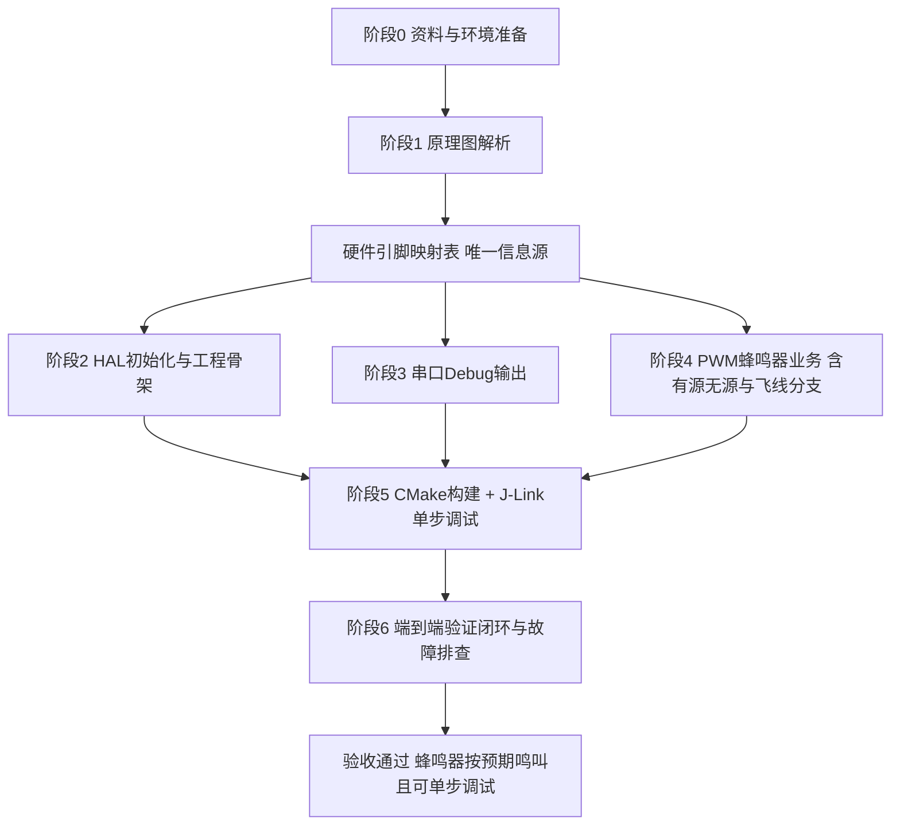

# STM32 蜂鸣器 PWM 全 AI 生成工作流（CodeBuddy IDE 版）

> **本次交付范围声明**：本文件是**工作流方案**，不是工程。本次没有创建 `CMakeLists.txt`、`.ioc`、调试配置文件、`.c` / `.h` 等任何工程实体文件，也没有修改原理图。文中所有形如 `Core/Src/main.c`、`CMakeLists.txt`、调试配置文件的路径，都是**后续按本工作流实际执行时才由 AI 生成的目标产物**，此刻并不存在。
>
> **执行环境**：整套工作流在 **CodeBuddy IDE**（Windows）中完成——用 `Plan` / `Craft` / `Ask` 模式推进，`@` 引用上下文，内置终端执行 PowerShell 命令，代码与配置全部由 AI 生成。底层的 STM32CubeMX(HAL) + CMake + Ninja + `arm-none-eabi-gcc` + J-Link GDB Server 工具链保持不变。
>
> **核心约束**：全程零代码输入。你只做三件事：把资料放进工作区、把每阶段的提示词复制给 AI、按验收清单核对结果。所有代码、配置、脚本、调试配置均由 AI 生成。

---

## 0. 如何使用本文档

1. 按 **阶段 0 → 阶段 6** 顺序推进，**每阶段必须通过验收门**才进入下一阶段，不要跳步。
2. 每阶段给出固定六要素：**输入 / AI 提示词 / AI 产出物 / 验证点 / 验收标准 / 失败回退**；六要素之外另附「**CodeBuddy 操作**」小节，说明该阶段用哪种模式、引用什么上下文、点哪里，不替代六要素。
3. 「AI 提示词」代码块可直接整段复制给 AI（代码块右上角「复制」即可）；其中的 `{占位符}` 由 AI 从阶段 1 产出的**硬件引脚映射表**自动填入，你不需要手工推算。
4. 验收标准全部是**可观测动作**（命令输出、终端日志、断点命中、变量值、波形频率），不出现「配置正确」这类无法验证的结论。
5. 阶段 1 的引脚映射表是**唯一硬件真相源**，后续所有提示词只引用表中的字段名，不硬编码引脚。换板或改引脚时只需更新这一张表。
6. **一个阶段一个 Plan**：阶段级工作用 `Plan` 模式新建计划，审阅（READY）即该阶段验收门，执行中局部修错切 `Craft`，概念核对用 `Ask`；阶段完成（FINISHED）后归档到 `.codebuddy/plans/`，下一阶段新建计划并用 `@` 引用归档结果。
7. 官方使用原则要求「单一 Plan 聚焦单一功能模块，功能模块完成后再开始下一个」，切勿把 7 个阶段塞进一个大 Plan。

### 0.1 占位符约定与本板取值

| 占位符 | 含义 | 本板取值（来自原理图解析，阶段 1 复核后生效） |
| --- | --- | --- |
| `{MCU}` | MCU 型号 | `STM32F103ZET6`，LQFP144，Cortex-M3 |
| `{HSE_MHZ}` / `{LSE_KHZ}` | 外部晶振 | `8` MHz / `32.768` kHz |
| `{SYSCLK_MHZ}` | 目标系统时钟 | `72` MHz |
| `{BUZZER_NET}` | 蜂鸣器网络名 | `BEEP/BOOT1` |
| `{BUZZER_PORT}` / `{BUZZER_PIN}` | 蜂鸣器 GPIO | `GPIOB` / `GPIO_PIN_2`（PB2，LQFP144 pin 48） |
| `{BUZZER_ACTIVE_LEVEL}` | 有效电平 | 高电平鸣叫（**待实测确认**） |
| `{BUZZER_TYPE}` | 蜂鸣器类型 | 疑似**有源**（**必须实测确认**） |
| `{BUZZER_TIM}` / `{BUZZER_TIM_CH}` | 硬件 PWM 外设与通道 | **PB2 无 TIM 通道**；飞线方案为 `TIM3` / `TIM3_CH3`（PB0） |
| `{PWM_FALLBACK_PIN}` | 可飞线的硬件 PWM 口 | `PWM0` = PB0 / TIM3_CH3，`PWM1` = PB1 / TIM3_CH4（CN1 扩展口） |
| `{DEBUG_USART}` | Debug 串口 | `USART1` |
| `{DEBUG_TX_PIN}` / `{DEBUG_RX_PIN}` | Debug TX / RX | `PA9`（pin 101） / `PA10`（pin 102） |
| `{DEBUG_BAUD}` | 波特率 | `115200` |
| `{DEBUG_LEVEL}` | 物理电平与接线 | 板上 `CON1` 是 **RS232** 电平；TTL 版需从扩展排针取 PA9/PA10 |
| `{SWDIO_PIN}` / `{SWCLK_PIN}` | SWD 引脚 | `PA13`（pin 105） / `PA14`（pin 109） |
| `{PWM_PATH}` | PWM 实现路径（阶段 1 决策门选定） | A 软件 PWM / B 飞线硬件 PWM / C 换无源蜂鸣器 + B |
| `{JLINK_DEVICE}` | J-Link 器件名 | `STM32F103ZE` |
| `{SVD}` | SVD 文件 | 阶段 0 实测：`STM32F103xx.svd`，绝对路径 `C:\Users\HenrryBian\AppData\Local\Programs\EmbeddedTools\Keil.STM32F1xx_DFP.2.4.1\SVD\STM32F103xx.svd`（867312 字节，来自 Keil STM32F1 DFP 2.4.1；旧值 `STM32F103.svd` 不存在） |
| `{BOOT0_JP}` / `{BOOT1_JP}` / `{BEEP_JP}` / `{JTAG_SEL_JP}` | 关键跳线 | `JP8` / `JP9` / `JP5` / `JP6` |
| `{IDE}` | 开发前端 | `CodeBuddy IDE`（Windows） |
| `{CB_MODE}` | 阶段级交互模式 | `Plan`（局部修复 `Craft`、概念核对 `Ask`） |
| `{CB_PLAN_DIR}` | 计划归档目录 | `.codebuddy/plans/` |
| `{CB_SKILL}` | 原理图解析技能 | `pdf` skill（用户/项目级 `.codebuddy/skills/`） |
| `{CB_EXT_AVAILABLE}` | 阶段 0 探测的调试扩展可用性结论 | 阶段 0 实测：**已安装** `marus25.cortex-debug 1.13.0-pre6`（`C:\Users\HenrryBian\.codebuddycn\extensions\marus25.cortex-debug-1.13.0-pre6-universal`，4/4 个 `mcu-debug.*` 依赖齐全）→ 阶段 5 走图形化单步**主选**；命令行 GDB 保留为兜底 |

### 0.2 阶段门总览



> 图中每个阶段对应**一个独立的 Plan**；模式映射与界面入口见 0.3。图中保持不含具体 IDE 名称，阶段门结构不随前端变化。

### 0.3 CodeBuddy 模式与入口总览

| 环节 | 用什么 | 在哪里操作 |
| --- | --- | --- |
| 新建计划 | `Plan` 模式 | 侧栏 `Plan Mode` → 计划概览 → 「新建计划」；或点输入框左下 `Ask ▾` 切到 `Plan` |
| 干净上下文 | `New Chat` | 顶部新建会话标签，避免与已完成计划（如「任务列表 6/6」）混在同一上下文 |
| 需求澄清 | PREPARE | 粘贴阶段提示词 → 回答 1–2 个澄清问题 → 确认需求总结 |
| 方案审阅 | READY | 编辑正文 / 技术方案 / 任务列表，确认含验收门与失败回退后点「开始执行」 |
| 执行与修错 | BUILDING / `Craft` | 任务按序执行；编译报错、日志乱码等局部问题切 `Craft` 快修，再回到计划继续 |
| 概念核对 | `Ask` | 核对 HAL API、SVD 字段、引脚复用，不改动文件 |
| 上下文引用 | `@` | 引用本文档、`docs/hardware_pins.md`、`.codebuddy/plans/` 中的归档计划 |
| 命令执行 | 内置终端 | AI 调用终端工具执行 PowerShell（cmake、ninja、烧录、GDB 等） |
| 扩展能力 | Skills / Rules / MCP | `pdf` skill 解析原理图；`.codebuddy/rules` 固化「零代码、不臆造引脚、PowerShell 兼容」 |
| 归档复用 | FINISHED | 计划自动保存为 Markdown 到 `.codebuddy/plans/`，下一阶段 `@` 引用 |

---

## 阶段 0：资料与环境准备

### 输入

- 原理图：`红牛开发板电路图(RedBull Schematic).pdf`（3 页，792×612 pt 矢量 PDF，含完整文字层、无位图）。
- 硬件：红牛开发板、`J-Link` 调试器（含 20pin ARM JTAG 转接）、USB-TTL 或 RS232-USB 线、示波器或逻辑分析仪（可用 J-Link + 变量观察替代）、USB 供电线。
- 软件：CodeBuddy IDE（内置终端 + `Plan`/`Craft`/`Ask` 模式 + Skills/Rules）、STM32CubeMX、CMake、Ninja、`arm-none-eabi-gcc`、SEGGER J-Link 软件包；调试前端主选插件市场中的 `Cortex-Debug` 扩展（**可用性待探测**），兜底为内置终端 + `JLinkGDBServerCL` + `arm-none-eabi-gdb` 命令行。

### CodeBuddy 操作

| 字段 | 本阶段取值 |
| --- | --- |
| 模式选择 | 阶段级用 `Plan` 新建计划；校验命令跑不通时切 `Craft` 快修；查工具概念用 `Ask` |
| `@` 引用对象 | 本文档（阶段 0 章节）、`红牛开发板电路图(RedBull Schematic).pdf`（仅确认可读，本阶段不解析） |
| 入口动作 | `New Chat` → 输入框左下 `Ask ▾` 切 `Plan` → 新建计划 → 粘贴下方提示词 → 回答澄清问题 → READY 审阅任务列表 → 开始执行；AI 在内置终端跑 PowerShell 校验命令 |
| 可用扩展能力 | `pdf` skill（阶段 1 才用）、`.codebuddy/rules`（零代码 / PowerShell 兼容约束）、内置终端命令执行 |

### AI 提示词（可直接复制）

```text
你是 STM32 嵌入式工程助手。请为一块 STM32F103ZET6 红牛开发板准备"零手写代码"开发环境，全部工作将在 CodeBuddy IDE 中完成。

输入上下文：
- 工作区已有原理图《红牛开发板电路图(RedBull Schematic).pdf》，但本阶段不需要解析它。
- 目标工具链：CodeBuddy IDE（Plan/Craft/Ask 模式 + 内置终端 + @ 上下文引用）作为开发前端，底层为 STM32CubeMX(HAL) + CMake + Ninja + arm-none-eabi-gcc + J-Link GDB Server。
- 调试前端：主选 CodeBuddy 插件市场中的 Cortex-Debug 扩展（F5 图形化单步），兜底为内置终端 + JLinkGDBServerCL + arm-none-eabi-gdb 命令行单步；**本阶段只探测可用性，不生成调试配置**。
- 运行平台：Windows + PowerShell。

硬约束：
1. 禁止要求用户手写任何 C/C++/汇编代码；你负责生成所有代码与配置。
2. 所有命令必须兼容 PowerShell，不使用 bash 专属语法；含空格或括号的路径一律加引号。
3. 不确定的工具安装路径、CodeBuddy 安装目录与扩展市场配置不要编造，改为输出"探测命令"让用户回传结果。
4. Cortex-Debug 扩展是否可安装尚未实测：只输出探测步骤与"可用 → 主选 / 不可用 → 命令行 GDB 兜底"的判定规则，不得断言一定可用。
5. J-Link 命令行参数先用 --help 探测，不凭记忆编造。

请产出：
1. 一份"环境校验命令清单"（PowerShell 片段），逐项检查 cmake、ninja、arm-none-eabi-gcc、arm-none-eabi-gdb、JLinkGDBServerCL、STM32CubeMX、STM32F1 CMSIS Pack/SVD 文件是否可用并输出版本号；另给出 CodeBuddy 环境探测步骤（能否进入 Plan 模式、内置终端能否执行 PowerShell、@ 能否引用文件、插件市场能否搜到 Cortex-Debug）。
2. 一张"工具 / 用途 / 预期版本输出 / 缺失时安装方式"表格（安装方式可用 winget 或官方安装包路径说明；扩展安装写清插件市场入口与兼容设置）。
3. 一份"依赖就绪判定规则"：哪些是必须项，哪些是可选项（例如示波器、Cortex-Debug 扩展可缺省，因有命令行 GDB 兜底）。
4. 明确列出绝对不能做的硬件操作（例如带电插拔 JTAG、把 5V 接到 3.3V 引脚）。

验收命令：给出一条可一键运行的 PowerShell 校验命令，让用户把输出回传给你判断；CodeBuddy 侧探测结果以界面截图或内置终端输出回传。
```

### AI 产出物

- 环境校验命令清单与工具对照表（后续执行时可保存为 `docs/env_check.md`，**本次不生成**）。
- 依赖就绪判定规则与硬件操作禁忌清单。

### 验证点

```powershell
Get-Command cmake, ninja, arm-none-eabi-gcc, arm-none-eabi-gdb, JLinkGDBServerCL -ErrorAction SilentlyContinue |
    Select-Object Name, Source
cmake --version
ninja --version
arm-none-eabi-gcc --version
arm-none-eabi-gdb --version
Get-ChildItem "C:\Program Files\STMicroelectronics" -ErrorAction SilentlyContinue | Select-Object Name
Get-ChildItem "C:\Program Files\SEGGER" -ErrorAction SilentlyContinue | Select-Object Name
```

CodeBuddy 侧不臆造命令，由 AI 按本机实际情况生成探测步骤、在内置终端执行并回传结果：

- 侧栏 `Plan Mode` 可进入且能「新建计划」；输入框左下 `Ask ▾` 可切到 `Plan` / `Craft` / `Ask`。
- 内置终端可执行上述 PowerShell 命令，输出可回传给 AI。
- `@` 可引用本文档与原理图 PDF。
- 插件市场可搜索 `Cortex-Debug`（官方 FAQ 提示可在设置中配置 `marketplace.visualstudio.com` 解决扩展兼容）；搜不到则记录「主选不可用」。

### 验收标准

- `cmake`、`ninja`、`arm-none-eabi-gcc`、`arm-none-eabi-gdb` 四条 `--version` 均返回有效版本号，无「不是内部或外部命令」。
- 在 CodeBuddy 中能新建 `Plan`、切换到 `Craft`、内置终端能执行上述命令且输出可回传，`@` 能引用本文档。
- 主选路径的 `Cortex-Debug` 扩展可用性已有明确结论：可安装 → 阶段 5 走图形化单步；不可安装 → 阶段 5 走命令行 GDB 兜底。两种结论都不阻塞阶段 0 通过。
- 能定位到 J-Link 安装目录（存在 `JLinkGDBServerCL.exe`）与 STM32F1 的 `.svd` 文件路径。
- 用户把上述校验输出回传给 AI，AI 明确回复「必须项全部就绪」或列出具体缺项。

### 失败回退

| 现象 | 回退动作 |
| --- | --- |
| `arm-none-eabi-gcc` 找不到 | 让 AI 生成 winget / 官方 GNU Arm Embedded Toolchain 安装命令，并把 `bin` 目录追加到当前会话 `$env:PATH`，重新校验 |
| 找不到 `.svd` | 让 AI 从 STM32CubeMX 或 Keil Pack 安装目录搜索 `STM32F103*.svd`，把实际路径写进引脚映射表 |
| `JLinkGDBServerCL` 不在 PATH | 记录绝对路径，后续所有调试配置使用绝对路径，不依赖 PATH |
| 侧栏找不到 `Plan Mode` / 无法新建计划 | 确认使用 CodeBuddy IDE 版并已登录；点输入框左下 `Ask ▾` 查看模式下拉；把界面截图回传给 AI 定位 |
| 插件市场搜不到 `Cortex-Debug` | 按官方 FAQ 在设置中配置 `marketplace.visualstudio.com` 后重启；仍不可用则记录「主选不可用」，阶段 5 直接采用命令行 GDB 兜底 |
| 内置终端无法执行命令 | 切 `Craft` 模式让 AI 重跑单条命令定位，回传错误文本，不要跳过环境校验 |
| 原理图 PDF 打不开 | 回到本阶段输入项，确认文件名为 `红牛开发板电路图(RedBull Schematic).pdf` 且可读 |

---

## 阶段 1：原理图解析与硬件引脚映射表（唯一硬件真相源）

### 输入

- `红牛开发板电路图(RedBull Schematic).pdf`（3 页）。
- 开发板实物（用于丝印、跳线、蜂鸣器型号核对）。

### CodeBuddy 操作

| 字段 | 本阶段取值 |
| --- | --- |
| 模式选择 | 阶段级用 `Plan` 新建一个独立计划；PDF 解析细节可让 AI 调用 `pdf` skill；对解析结论有疑问用 `Ask` 问答，不改文件 |
| `@` 引用对象 | 原理图 PDF、本文档 0.1 占位符表、阶段 0 归档计划（`.codebuddy/plans/`） |
| 入口动作 | `New Chat` → `Ask ▾` 切 `Plan` → 新建计划 → 粘贴提示词 → READY 审阅「解析字段 + 证据页码 + 置信度 + 人工复核清单」是否齐全 → 开始执行 |
| 可用扩展能力 | `pdf` skill（文字层抽取 / 页面渲染成图片做视觉核对）、多模态输入（贴渲染图或实物照片）、内置终端（跑解析命令）、`.codebuddy/rules`（禁止臆造引脚） |

### AI 提示词（可直接复制）

```text
你是硬件原理图分析助手。请解析工作区中的《红牛开发板电路图(RedBull Schematic).pdf》，产出一份"硬件引脚映射表"。

输入上下文：
- PDF 共 3 页，是 Protel/Altium 导出的矢量 PDF，含文字层（约 36 处字体引用、无位图）。
- 图纸文件名 F:\STM32-X5.Ddb，日期 2009-04-28。

硬约束：
1. 必须区分"图纸文字明确写出的事实"与"根据电路推断的结论"，分别标注置信度（高/中/低）和证据页码。
2. 严禁臆造型号、引脚号、定时器通道；无法从图纸确认的项一律写入"待人工确认"，并给出实测判定方法。
3. PDF 文字层缺失时，回退路径为：把页面渲染成图片 → 视觉识别/OCR → 仍不明确则用万用表通断档实测，禁止猜测。
4. 输出表格化，字段名固定，方便后续提示词直接引用。

请至少抽取并核对以下字段：
- MCU 型号、封装、内核、Flash/SRAM；HSE/LSE 晶振频率与引脚。
- 蜂鸣器网络名、所接 GPIO 与物理引脚号、驱动电路（三极管型号/基极电阻/供电）、有效电平、有源或无源的判定依据。
- 该 GPIO 是否具备 TIMx_CHy 复用能力；若不具备，列出板上所有可用作硬件 PWM 输出且已引到扩展口的引脚及其定时器通道。
- Debug 串口：USART 编号、TX/RX 引脚、板载电平转换芯片、连接器编号、是 TTL 还是 RS232 电平。
- SWD/JTAG：SWDIO、SWCLK、SWO、nRST 引脚；调试连接器编号与针数；JTAG/SWD 选择跳线编号。
- BOOT0 / BOOT1 跳线编号与默认状态；蜂鸣器使能跳线编号；复位电路。
- 每项给出证据页码（P1/P2/P3）与置信度。

最后额外输出一张"人工复核清单"，每项写清楚：看哪里、怎么量、预期结果是什么。

本阶段在 CodeBuddy IDE 中完成：可用 `pdf` skill 抽取文字层，并把页面渲染成图片供视觉核对；解析结论写入 `docs/hardware_pins.md` 后锁定，后续阶段通过 `@` 引用该文件，不得在各阶段重复猜测引脚。
```

### AI 产出物

- `docs/hardware_pins.md`（**后续执行工作流时才生成**）：硬件引脚映射表 + 证据表 + 人工复核清单。
- 所有后续阶段提示词中的占位符取值来自这张表。

### 1.1 本机已完成的真实解析结果（可直接作为映射表基线）

> 以下内容由 AI 对当前工作区原理图实际解析得到，文字层与渲染图双向核对。请仍按 1.2 清单人工复核后再锁定。

| 字段 | 值 | 证据 | 置信度 |
| --- | --- | --- | --- |
| MCU | `STM32F103ZET6`，LQFP144，Cortex-M3，最高 72 MHz | P1 `U1 STM32F103ZET6`、144 脚符号 | 高 |
| HSE | `Y2 8 MHz` + C21/C22 20 pF → `OSC_IN`(23) / `OSC_OUT`(24) | P1 | 高 |
| LSE | `Y1 32.768 kHz` + C19/C20 10 pF → `PC14`(8) / `PC15`(9) | P1 | 高 |
| 蜂鸣器网络 | `BEEP/BOOT1`，即 **PB2 / BOOT1，LQFP144 pin 48** | P1 网络标签 `BEEP/BOOT1`、`PB2/BOOT1 48`、`R25 10K → PB2` | 高 |
| 蜂鸣器驱动 | `BEEP` → `JP5` 使能跳线 → `R39 1K` → `Q1 (NPN)` 基极；Q1 发射极接地，集电极接蜂鸣器；蜂鸣器上端经 `DZ1`(5V) 接 5V | P1 左下（Q1、JP5、R39、DZ1、BEEP 符号） | 高 |
| 有效电平 | **高电平鸣叫**：PB2=1 → Q1 导通 → 蜂鸣器得电；PB2=0 静音 | 由 NPN 开关电路推断 | 中高（须实测） |
| 蜂鸣器类型 | **疑似有源**：5V 经稳压管 + 单管开关驱动，图上为 `BEEP` 器件符号，且设计者选择了无 PWM 能力的 PB2 | 由电路推断 | 中（**必须实测**） |
| **关键硬件约束** | **PB2 没有任何 TIMx_CHy 复用**，无法输出硬件 PWM | P1 引脚表 `PB2/BOOT1 48` 无 TIM 功能；相邻 PB0/PB1 才有 TIM3_CH3/CH4 | 高 |
| 可用硬件 PWM 口 | `CN1`(CON10) 扩展口：`PWM0` = **PB0 / TIM3_CH3**(46)，`PWM1` = **PB1 / TIM3_CH4**(47)；另有 `AIN0~2`=PC0~2、`DAC0`=PA4、`DAC1`=PA5 | P3 `CN1`；P1 `PB0/.../TIM3_CH3/...46`、`PB1/.../TIM3_CH4/...47` | 高 |
| Debug 串口（TTL 侧） | `USART1`：TX `PA9`(101) / RX `PA10`(102)；`USART2`：TX `PA2`(36) / RX `PA3`(37) | P1 引脚表；P3 `U1TX/U1RX/U2TX/U2RX` | 高 |
| **串口电平陷阱** | 板载 `CON1 UART1` / `CON2 UART2` 是 **RS232 电平**（`U5 ST3232` + DB9），**不是 TTL**，不能直接接 USB-TTL | P3 `U5 ST3232`、`RS232_RX1/TX1`、`CON1/CON2` | 高 |
| 其他串口 | `USART3` PB10/PB11 已接 `U7 MAX485`（RS485），`485_DIR`=PF11，不适合做 Debug 口 | P3 | 高 |
| SWD 引脚 | `PA13 / JTMS-SWDIO`(105)、`PA14 / JTCK-SWCLK`(109)；`PB3 / JTDO-TRACESWO`(133)、`PB4 / JNTRST`(134)、`PA15 / JTDI`(110) | P1 | 高 |
| 调试连接器 | `J5` 标准 **20pin ARM JTAG**（pin1 Vref=3V3、pin7 TMS、pin9 TCK、pin15 nSRST，偶数脚 GND）；`JP6 JTAG_SEL`（2×5 跳线）用于 JTAG/SWD 选择，右侧引出 `SWDIO` / `SWCLK` | P1 右下 | 高 |
| BOOT / 使能跳线 | `JP8 BOOT0`、`JP9 BOOT1`（经 `R25 10K` 到 PB2）、`JP5 BEEP`（蜂鸣器使能）、`JP4 Power`、`JP6 JTAG_SEL` | P1 | 高 |
| 复位 | `S1 RESET` + `C38 100nF` + `R26 10K` → `NRST`(25)，`R49 0R` → J5 nSRST | P1 | 高 |
| 供电 | 3V3 数字/模拟分区滤波（`L2 10uH`、`R47/R48 10R`），5V 供蜂鸣器 | P1 | 高 |

### 1.2 人工复核清单（验收门，必须逐项打勾）

| # | 复核项 | 怎么看 / 怎么量 | 预期结果 |
| --- | --- | --- | --- |
| 1 | `JP5 BEEP` 是否短接 | 目视跳线帽 | 短接，否则蜂鸣器永远不响 |
| 2 | `JP6 JTAG_SEL` 模式 | 对照板上丝印与原理图 P1 右下 | 设为 J-Link 所需模式，SWDIO/SWCLK 有效 |
| 3 | `JP8 BOOT0` | 目视跳线帽 | `BOOT0=0`（从主 Flash 启动），单步调试必需 |
| 4 | `JP9 BOOT1` 与 PB2 冲突 | 目视 + 原理图 | 确认 BOOT1 电平设置不会把 PB2 强拉到固定电平，导致 PWM 失效 |
| 5 | **蜂鸣器有源 / 无源** | 让 AI 生成一段"PB2 恒定输出高电平"的最小测试，运行后听声音 | 持续鸣叫 = **有源**；仅上电瞬间「嗒」一声 = **无源** |
| 6 | **有效电平** | 同上测试，分别置 PB2=1 与 PB2=0 | 确认哪一种响，回填 `{BUZZER_ACTIVE_LEVEL}` |
| 7 | Debug 串口接线方式 | 目视 `CON1` DB9 与扩展排针 | 用 `CON1` 必须配 **RS232-USB** 线；若用 USB-TTL，必须从扩展排针取 `PA9/PA10` TTL 并共地 |
| 8 | J-Link 接口匹配 | 目视 `J5` 20pin 与 J-Link 线 | 针距/转接板匹配；`Vref` 接 3V3；`GND` 共地 |
| 9 | 板卡版本一致性 | 板子丝印 vs 图纸 `F:\STM32-X5.Ddb`(2009-04-28) | 若版本不同，以实物丝印与万用表实测为准，并让 AI 更新映射表 |

### 1.3 阶段 1 决策门：选择 PWM 实现路径

由于 `BEEP = PB2` 无硬件 PWM 通道，必须在本阶段做出选择，并把结论写进映射表的 `{PWM_PATH}` 字段：

| 路径 | 是否改硬件 | 适用条件 | 效果 |
| --- | --- | --- | --- |
| **A. 定时器 + GPIO 软件 PWM（推荐起步）** | **不改** | 任意蜂鸣器类型 | 用 TIM 更新中断周期性翻转 PB2 产生方波；有源蜂鸣器得到「滴滴」节奏与占空比控制，无源蜂鸣器可变频鸣叫 |
| **B. 飞线到硬件 PWM（推荐追求纯硬件 PWM）** | 需要飞线 | 断开 `JP5` 的 PB2 侧，从 `CN1` 的 `PWM0`(PB0/TIM3_CH3) 引到蜂鸣器驱动输入 | `HAL_TIM_PWM_Start` 直接输出硬件 PWM，频率/占空比由 ARR/CCR 精确控制 |
| **C. 更换蜂鸣器 + 路径 B** | 需要焊接 | 确认为有源蜂鸣器且希望变频改变音调 | 换成无源蜂鸣器后可真正「变调鸣叫」 |

> **重要认知**：**有源蜂鸣器无法通过 PWM 变频改变音调**，PWM 只能控制通断节奏与占空比（音量/断续）；只有**无源蜂鸣器**才能靠改变频率改变音调。阶段 4 的提示词会按 `{BUZZER_TYPE}` 与 `{PWM_PATH}` 自动分支，避免生成与硬件不符的业务行为。

### 验证点 / 验收标准 / 失败回退

- **验证点**：映射表每个字段都有证据页码与置信度；9 项人工复核清单全部有实际结论；`{PWM_PATH}` 已选定。
- **验收标准**：AI 回复「映射表已锁定，共 N 项高置信、M 项已实测确认、0 项臆造」，且第 5、6、7 项有实测结论；把映射表全文贴回给 AI，AI 能复述出 `{BUZZER_PIN}`、`{DEBUG_USART}`、`{SWDIO_PIN}` 三项且与实物一致。
- **失败回退**：
  - PDF 文字层缺失 → 渲染为 PNG → 视觉识别 / OCR → 仍不明确则万用表通断档实测。
  - 蜂鸣器类型与有效电平无法确认 → **不要进入阶段 4**，先让 AI 生成最小 GPIO 测试程序单独验证，拿到结论再回填。
  - 板卡版本与图纸不符 → 冻结所有「推断」项，仅保留实测项，让 AI 重写映射表后再推进。

---

## 阶段 2：HAL 初始化与工程骨架

### 输入

- 阶段 1 已锁定的硬件引脚映射表（含 `{MCU}`、`{HSE_MHZ}`、`{SYSCLK_MHZ}`、`{DEBUG_USART}`、`{SWDIO_PIN}`、`{SWCLK_PIN}`、`{PWM_PATH}`）。
- 阶段 0 已就绪的 CMake / Ninja / `arm-none-eabi-gcc` / STM32F1 HAL 与 CMSIS Pack。

### CodeBuddy 操作

| 字段 | 本阶段取值 |
| --- | --- |
| 模式选择 | `Plan` 新建独立计划（多文件协同是 Plan 的典型场景）；个别编译报错切 `Craft` 快修；核 HAL API 用 `Ask` |
| `@` 引用对象 | `docs/hardware_pins.md`（锁定版）、阶段 0/1 的 `.codebuddy/plans/` 归档计划、本文档阶段 2 提示词 |
| 入口动作 | 新建计划 → 粘贴提示词 → READY 审阅「文件清单 / Debug 构建 `-O0 -g3` / SWD 不复用」是否齐全 → 开始执行；AI 在内置终端跑 cmake 构建与 `arm-none-eabi-size` |
| 可用扩展能力 | 内置终端命令执行、`.codebuddy/rules`（零代码 / 不臆造 HAL API / PowerShell 兼容）、检查点（编译失败可回滚） |

### AI 提示词（可直接复制）

```text
你是 STM32 HAL 固件生成助手。请基于已锁定的 docs/hardware_pins.md 生成本项目的初始化层与工程骨架，用户不写任何代码。

输入上下文：
- MCU {MCU}；HSE {HSE_MHZ} MHz；目标 SYSCLK {SYSCLK_MHZ} MHz。
- Debug 串口 {DEBUG_USART}，TX {DEBUG_TX_PIN}，RX {DEBUG_RX_PIN}，波特率 {DEBUG_BAUD}。
- SWD：{SWDIO_PIN} / {SWCLK_PIN}；J-Link 器件名 {JLINK_DEVICE}。
- 蜂鸣器网络 {BUZZER_NET} = {BUZZER_PORT}/{BUZZER_PIN}，有效电平 {BUZZER_ACTIVE_LEVEL}；PWM 路径 {PWM_PATH}。
- 开发前端：CodeBuddy IDE（Plan 模式生成完整文件、内置终端执行构建命令）；底层工具链 CMake + Ninja + arm-none-eabi-gcc + STM32F1 HAL。

硬约束：
1. 全部代码与配置由你生成并以完整文件形式给出，用户零手写、零粘贴代码；禁止只给"在 main.c 里加几行"这类片段。
2. 严禁把 {SWDIO_PIN} / {SWCLK_PIN} 复用为 GPIO，禁止任何关闭 JTAG/SWD 的 remap 或 DBGMCU 配置；J-Link 全程可连。
3. 严禁编造不存在的 HAL API；不确定处描述意图并给可验证替代方案。
4. 启动文件、链接脚本、CMake 交叉工具链文件一并生成，并注明每个文件的来源（HAL 包 / CubeMX / 你生成）。
5. 提供 Debug 构建类型：-O0 -g3、保留符号与 SVD 路径占位，便于阶段 5 的图形化单步（主选）与命令行 GDB 单步（兜底）观察寄存器与变量；本阶段不生成调试前端配置。
6. 时钟配置后必须通过串口或变量可观测地确认 SystemCoreClock 实际值。

请产出（文件清单 + 每个文件职责 + 关键行为描述）：
1. 时钟树配置（HSE→PLL→{SYSCLK_MHZ} MHz，APB1/APB2 分频与 TIM 时钟说明）及对应的初始化调用顺序。
2. GPIO / 串口 / 定时器（按 {PWM_PATH} 决定是否启用 TIM）的初始化代码文件。
3. 启动文件、链接脚本、中断向量表与 SysTick 时基配置。
4. CMakeLists.txt 与 cmake 工具链文件，包含 Debug/Release 两种构建类型、生成 .elf/.hex/.bin 的规则、size 输出。
5. 可选：对应的 STM32CubeMX .ioc 配置说明，便于日后图形化改动。
6. 一份"初始化自检清单"，列出上电后应能观测到的 5 个事实。
```

### AI 产出物

> 以下均为**后续执行工作流时才生成**的目标产物，本次未创建。

- `Core/Inc/main.h`、`Core/Src/main.c`、`Core/Src/stm32f1xx_it.c`、`Core/Src/system_stm32f1xx.c`
- `startup_stm32f103xe.s`、`STM32F103ZETx_FLASH.ld`
- `CMakeLists.txt`、`cmake/gcc-arm-none-eabi.cmake`
- `docs/clock_tree.md`、`docs/init_selfcheck.md`
- 可选 `{MCU}.ioc`（CubeMX 工程）

### 验证点

- `HAL_Init()` → `SystemClock_Config()` → 外设初始化顺序正确；`SystemCoreClock` 实际值为 `{SYSCLK_MHZ}` MHz。
- `{DEBUG_USART}`、`{BUZZER_PORT}`、所需 TIM 的时钟均已使能。
- `{SWDIO_PIN}` / `{SWCLK_PIN}` 保持调试功能，未被 GPIO 初始化覆盖。
- CMake 交叉工具链文件正确指向 `arm-none-eabi-gcc`，Debug 构建含 `-O0 -g3`。

### 验收标准

```powershell
cmake -S . -B build/Debug -G Ninja -DCMAKE_BUILD_TYPE=Debug
cmake --build build/Debug
arm-none-eabi-size build/Debug/*.elf
```

- 配置与编译均返回 0 且 `0 error`，生成 `.elf` / `.hex` / `.bin` 三个文件。
- `arm-none-eabi-size` 输出 Flash/RAM 占用在 `{MCU}` 容量范围内。
- J-Link 连接后能识别 `{JLINK_DEVICE}` 并 halt 住内核（本阶段先不要求串口日志，那是阶段 3）。
- AI 交付的「初始化自检清单」5 项均写出可观测方式。

### 失败回退

| 现象 | 回退动作 |
| --- | --- |
| 链接脚本 / 启动文件不匹配 | 让 AI 按 `{MCU}` 的 Flash/RAM 容量重新生成，并与 CMSIS Pack 中的官方模板逐项比对 |
| J-Link 连不上 | 先查 `{JTAG_SEL_JP}` 跳线、`Vref` 3V3、共地；再让 AI 确认初始化代码没有禁用调试口 |
| 时钟与预期不符 | 让 AI 输出 RCC 寄存器期望值；图形化路径在 SVD 外设寄存器视图中对照 `RCC`，命令行 GDB 兜底路径由 AI 在内置终端用 `arm-none-eabi-gdb` 读 RCC 寄存器定位分频错误 |
| 编译报错来自缺失 HAL 驱动 | 让 AI 补齐 `stm32f1xx_hal_*.c` 到构建源列表，或改用 CubeMX 生成完整驱动集 |

---

## 阶段 3：串口 Debug 输出

### 输入

- 阶段 2 工程骨架与 `{DEBUG_USART}` 初始化。
- 阶段 1 复核结论：`{DEBUG_LEVEL}`（RS232 还是 TTL）、实际接线方式。

### CodeBuddy 操作

| 字段 | 本阶段取值 |
| --- | --- |
| 模式选择 | `Plan` 新建独立计划；日志重定向链接冲突、乱码等局部问题切 `Craft` 快修 |
| `@` 引用对象 | `docs/hardware_pins.md`、阶段 2 生成的 `Core/Src/main.c` 与 `CMakeLists.txt`、阶段 2 归档计划 |
| 入口动作 | 新建计划 → 粘贴提示词（明确 `{DEBUG_LEVEL}`）→ READY 审阅「重定向实现 / 日志等级 / 接线对照表」→ 开始执行；串口终端日志文本贴回会话，或由 AI 在内置终端读取串口输出 |
| 可用扩展能力 | 内置终端（跑构建与串口读取脚本）、多模态输入（贴终端截图让 AI 判断乱码）、`.codebuddy/rules`（禁止中断中 `printf`、日志低频） |

### AI 提示词（可直接复制）

```text
你是 STM32 固件调试输出助手。请为已生成的工程加入串口 Debug 输出能力，用户不写任何代码。

输入上下文：
- Debug 串口 {DEBUG_USART}，TX {DEBUG_TX_PIN}，RX {DEBUG_RX_PIN}，波特率 {DEBUG_BAUD}，8N1。
- 板载 DB9 连接器 CON1/CON2 经 ST3232 是 RS232 电平；若用户选择 TTL 接线，则信号从扩展排针取 {DEBUG_TX_PIN}/{DEBUG_RX_PIN}。当前选定接线方式：{DEBUG_LEVEL}。
- 调试器为 J-Link SWD；单步调试前端在阶段 5 确定（主选图形化单步，兜底为内置终端 + 命令行 GDB），本阶段只需保证日志与执行顺序一致。

硬约束：
1. 用 printf 重定向到 {DEBUG_USART}（__io_putchar / _write + HAL_UART_Transmit），阻塞式优先，保证单步时日志与执行顺序一致。
2. 提供带等级的日志宏（ERROR/WARN/INFO/DEBUG），可编译期开关等级；日志低频、单行、不含敏感信息。
3. 严禁在中断服务函数中调用 printf；严禁高频刷屏（例如每个 PWM 周期都打印），避免单步调试时信息不可读。
4. 全部代码由你生成并以完整文件形式给出；禁止要求用户手写或粘贴代码。
5. 明确说明接线电平陷阱：RS232 电平与 TTL 电平不可混接，必须共地。

请产出：
1. 串口重定向实现文件与日志头文件（完整文件），以及需要修改的现有文件清单。
2. 上电启动日志内容：固件版本、编译时间、{MCU}、SYSCLK 实际值、{DEBUG_USART} 与波特率、蜂鸣器引脚与 PWM 路径摘要。
3. 一份"串口终端配置清单"（波特率、数据位、停止位、流控、换行处理、推荐终端软件）与"接线对照表"（DB9 / 扩展排针 / USB-TTL 三种情况）。
4. 一条可验证的验收命令或操作步骤：上电后终端应看到什么。
```

### AI 产出物

> 后续执行工作流时才生成：`Core/Src/debug_uart.c`、`Core/Inc/debug_log.h`、`docs/uart_wiring.md`，以及对 `main.c` / `CMakeLists.txt` 的增补。

### 验证点

- 重定向函数被链接器正确接管（`_write` 或 `__io_putchar` 生效，无 `undefined reference` 或链接冲突）。
- 上电瞬间即输出启动日志，不依赖任何按键或外部触发。
- 日志等级宏在 Debug 构建下开启 INFO/DEBUG，Release 下可关闭。
- 中断上下文中不存在 `printf` 调用。

### 验收标准

- 串口终端以 `{DEBUG_BAUD}` / 8N1 / 无流控打开，复位板子后**稳定看到启动日志**，且 `SYSCLK` 数值等于 `{SYSCLK_MHZ}` MHz。
- 日志每行完整、无乱码、无截断；连续复位 3 次结果一致。
- 在日志输出语句处设断点（图形化路径用断点 + `F10`；命令行 GDB 兜底路径用 `break` + `next`），单步执行后终端才出现下一行，证明日志与执行顺序一致、可用于后续单步调试定位。

### 失败回退

| 现象 | 回退动作 |
| --- | --- |
| 终端无任何输出 | 按 `{DEBUG_LEVEL}` 复查接线：CON1 是 RS232 电平，误接 USB-TTL 会无输出甚至有风险；确认共地、TX/RX 交叉、波特率 |
| 乱码 | 让 AI 核对 `{HSE_MHZ}` 与 PLL 配置（波特率依赖时钟），并确认终端字符编码与换行设置 |
| `printf` 无输出但不报错 | 让 AI 检查是否启用了 `nano.specs` / `-u _printf_float` 等链接选项，或改用 `__io_putchar` 实现 |
| 日志刷屏导致单步困难 | 让 AI 降低日志频率，只在状态切换时输出，并把等级调到 WARN |

---

## 阶段 4：PWM 蜂鸣器业务（含类型分支与路径分支）

### 输入

- 阶段 1 锁定项：`{BUZZER_TYPE}`（有源 / 无源）、`{BUZZER_ACTIVE_LEVEL}`（实测）、`{PWM_PATH}`（A 软件 PWM / B 飞线硬件 PWM / C 换无源蜂鸣器 + B）。
- 阶段 2 的 TIM/GPIO 初始化、阶段 3 的日志能力。

### CodeBuddy 操作

| 字段 | 本阶段取值 |
| --- | --- |
| 模式选择 | `Plan` 新建独立计划（业务分支多，正是需要 READY 审阅的场景）；状态机细节调整切 `Craft`；有源/无源语义疑问用 `Ask` |
| `@` 引用对象 | `docs/hardware_pins.md`（锁定 `{BUZZER_TYPE}` / `{BUZZER_ACTIVE_LEVEL}` / `{PWM_PATH}`）、`docs/buzzer_sequence.md`、阶段 1–3 归档计划 |
| 入口动作 | 新建计划 → 粘贴提示词并在澄清阶段回答三个锁定项 → READY 重点审阅「有源不生成变频逻辑」「路径 A/B/C 分支正确」「非阻塞状态机」→ 开始执行；飞线操作按 AI 给的接线表人工完成并断电 |
| 可用扩展能力 | 内置终端（构建、烧录、可选读取串口日志）、多模态输入（贴示波器波形或终端截图让 AI 判定）、`.codebuddy/rules`（禁止 `HAL_Delay`、禁止臆造 HAL API） |

### AI 提示词（可直接复制）

```text
你是 STM32 业务代码生成助手。请实现"蜂鸣器以 PWM 方式鸣叫"，用户不写任何代码。

输入上下文（全部来自已锁定的 docs/hardware_pins.md，禁止自行改引脚）：
- 蜂鸣器网络 {BUZZER_NET} = {BUZZER_PORT}/{BUZZER_PIN}，有效电平 {BUZZER_ACTIVE_LEVEL}（已实测）。
- 蜂鸣器类型 {BUZZER_TYPE}；PWM 实现路径 {PWM_PATH}。
- 关键硬件事实：{BUZZER_PIN} 无任何 TIMx_CHy 复用，不能直接输出硬件 PWM。
- 可用硬件 PWM 扩展口：{PWM_FALLBACK_PIN}（PWM0 = PB0/TIM3_CH3，PWM1 = PB1/TIM3_CH4，位于 CN1）。
- 已有 {DEBUG_USART} 日志能力与 J-Link SWD 单步调试环境。

硬约束：
1. 先按两个分支生成正确的业务语义，不得混淆：
   - {BUZZER_TYPE}=有源：PWM 只能控制通断节奏与占空比（音量/断续），**不能变频变音调**；鸣叫序列用"响/停 + 占空比"表达。
   - {BUZZER_TYPE}=无源：PWM 频率决定音调，可用频率序列实现变调鸣叫，频率范围与蜂鸣器谐振频率匹配。
2. 按 {PWM_PATH} 生成实现：
   - 路径 A（不改硬件）：用一个 TIM 产生周期性更新中断，在中断中按设定频率/占空比翻转 {BUZZER_PORT}/{BUZZER_PIN}（软件 PWM）；中断内禁止 printf、禁止耗时运算。
   - 路径 B（飞线硬件 PWM）：把蜂鸣器驱动输入从 {BUZZER_PIN} 改接 {PWM_FALLBACK_PIN}，用 HAL_TIM_PWM_Start 输出，频率由 PSC/ARR 决定、占空比由 CCR 决定；同时给出飞线接线说明与"断开原 PB2 侧"的确认步骤。
   - 路径 C：在路径 B 基础上增加"更换为无源蜂鸣器"的硬件改动说明与验收差异。
3. 鸣叫控制必须是**非阻塞状态机**：基于 HAL_GetTick() 管理每段鸣叫时长、间歇、频率/占空比序列；主循环只调用一次 Tick 函数。严禁 HAL_Delay、严禁动态内存分配、严禁在循环中忙等。
4. 提供一组可单步观察的全局状态变量（当前段索引、目标频率、实际占空比、剩余时长）：图形化路径可在变量视图查看，命令行 GDB 兜底路径可用 print 读取；并在每次状态切换时输出一条 INFO 日志。
5. 全部代码由你生成并以完整文件形式给出；禁止要求用户手写或粘贴代码；禁止编造 HAL API。
6. 明确区分"有效电平"：占空比按 {BUZZER_ACTIVE_LEVEL} 定义，避免反相导致有声/无声颠倒。

请产出：
1. 蜂鸣器驱动模块（完整 .c/.h）与对 main.c / 中断文件 / CMakeLists.txt 的增补清单。
2. 默认鸣叫序列的表（频率、占空比、时长、间歇）及其设计理由，说明有源/无源两种类型下的实际听感差异。
3. 路径 B/C 时的飞线接线表（从 CN1 哪个针脚到 JP5 哪一端、需要断开什么、共地要求），并标注"操作前断电"。
4. 单步调试观察清单：在哪个函数设断点、单步几步后应观察到哪些变量变化。
5. 验收命令与波形核验方法：如何用示波器/逻辑分析仪测量频率与占空比，以及没有仪器时如何用变量与日志替代验证。
```

### AI 产出物

> 后续执行工作流时才生成：`Core/Src/buzzer.c`、`Core/Inc/buzzer.h`、`docs/buzzer_sequence.md`、`docs/pwm_path_wiring.md`，以及对 `main.c` / `stm32f1xx_it.c` / `CMakeLists.txt` 的增补。

### 验证点

- `{BUZZER_TYPE}` 与 `{PWM_PATH}` 两个分支的语义正确：有源不生成「变频变音调」逻辑，无源才生成频率序列。
- 有效电平与实测一致：静音时 GPIO 处于无效电平，鸣叫段输出设定占空比。
- 主循环无阻塞；`Buzzer_Tick()` 每 tick 为 O(1)，中断内无 `printf`、无浮点重运算。
- 路径 B/C 的飞线说明包含断电操作与断开原 PB2 侧的确认步骤。
- 单步可观察变量确实暴露在 Debug 符号中（`-O0 -g3` 下未被优化掉）。

### 验收标准

- 编译通过（0 error），烧录后蜂鸣器按默认序列鸣叫，节奏与 `docs/buzzer_sequence.md` 一致。
- 串口终端在每次状态切换输出一条 INFO 日志，日志中的频率/占空比与配置表一致。
- 在 `Buzzer_Tick()` 设断点（图形化路径 `F10` 单步 + 变量视图；命令行 GDB 兜底路径 `break` / `next` + `print` 读变量），可依次观察到段索引、目标频率、占空比、剩余时长四个变量变化；继续运行后鸣叫不因断点暂停而乱序。
- 路径 B：示波器测 `{PWM_FALLBACK_PIN}` 输出频率与占空比，误差在 2% 以内；路径 A：中断翻转产生的方波频率与设定值一致，抖动在可接受范围。
- 静音段蜂鸣器确实无声，证明 `{BUZZER_ACTIVE_LEVEL}` 未取反。

### 失败回退

| 现象 | 回退动作 |
| --- | --- |
| 完全不响 | 复查 `{BEEP_JP}`(JP5) 是否短接、`{BOOT1_JP}`(JP9) 是否把 PB2 强拉固定电平、有效电平是否取反、5V 供电是否正常 |
| 有源蜂鸣器「变调」无效 | 这是硬件物理限制，不是代码 bug；让 AI 改为节奏/占空比序列，或改走路径 C 更换无源蜂鸣器 |
| 软件 PWM 频率不稳 / 音调抖动 | 让 AI 提高 TIM 中断优先级、精简中断内逻辑、避免在中断里做除法；必要时改用路径 B 硬件 PWM |
| 路径 B 飞线后仍无输出 | 让 AI 输出 TIM 的 PSC/ARR/CCR 期望值，图形化路径在 SVD 外设寄存器视图核对、命令行 GDB 兜底路径由 AI 在内置终端读寄存器核对；确认 GPIO 复用为 AF 输出 |
| 单步时变量被优化 | 让 AI 确认 Debug 构建为 `-O0 -g3`，并把状态变量声明为 `volatile` |
| 鸣叫阻塞日志 | 让 AI 移除 `HAL_Delay`，全部改为 `HAL_GetTick()` 状态机 |

---

## 阶段 5：CMake 构建与 CodeBuddy 中的 J-Link 单步调试（双路径）

### 输入

- 阶段 2-4 生成的完整工程（初始化、串口日志、蜂鸣器业务）。
- 阶段 0 定位到的 J-Link 安装路径、`{SVD}` 文件路径、`arm-none-eabi-gdb` 路径，以及「`Cortex-Debug` 扩展是否可安装」的探测结论。
- 阶段 1 复核结论：`{JTAG_SEL_JP}`(JP6) 已设为 SWD 可用模式，`J5` 20pin 已与 J-Link 正确连接，`Vref`=3V3、共地。
- 硬件连接：串口终端、蜂鸣器使能跳线 `{BEEP_JP}`(JP5)。

### CodeBuddy 操作

| 字段 | 本阶段取值 |
| --- | --- |
| 模式选择 | `Plan` 新建独立计划；扩展装不上、构建报错等局部问题切 `Craft`；查 GDB 命令或扩展字段含义用 `Ask` |
| `@` 引用对象 | `docs/hardware_pins.md`、`Core/Src/buzzer.c` 与 `CMakeLists.txt`、阶段 0/2/4 归档计划、阶段 0 的扩展可用性探测结论 |
| 入口动作 | 新建计划 → 粘贴提示词并在澄清阶段确认走主选还是兜底 → READY 审阅「两条路径的前提与验收标准都齐全」→ 开始执行；`{CB_PLAN_DIR}` 归档后供阶段 6 引用 |
| 可用扩展能力 | 插件市场（主选扩展安装）、内置终端（构建 / 烧录 / GDB Server / gdb 命令全部在此执行）、`.codebuddy/rules`（PowerShell 兼容、禁止臆造参数）、检查点（配置失败可回滚） |

**路径选择规则**：阶段 0 探测到 `Cortex-Debug` 扩展可用 → 走**主选**；扩展不可用、安装失败或调试会话起不来 → **直接切兜底**，不阻塞本阶段通过。两条路径共用同一套 CMake 构建与烧录脚本。

### AI 提示词（可直接复制）

```text
你是嵌入式构建与调试配置助手。请在 CodeBuddy IDE 中为已生成的工程配置 CMake 构建、J-Link 烧录与单步调试，用户不写任何代码。

输入上下文：
- 工程：{MCU}，CMake + Ninja + arm-none-eabi-gcc；Debug 构建 -O0 -g3。
- 开发前端：CodeBuddy IDE，Plan/Craft/Ask 模式、@ 上下文引用、内置终端；阶段 0 已探测扩展市场可用性，结论：{CB_EXT_AVAILABLE}。
- 调试器：J-Link，接口 SWD，器件名 {JLINK_DEVICE}，SVD 文件 {SVD}。
- SWD 引脚 {SWDIO_PIN}/{SWCLK_PIN}；板上调试连接器为 J5（20pin ARM JTAG），JTAG/SWD 由 {JTAG_SEL_JP} 选择。
- Debug 输出走 {DEBUG_USART} 串口，不是 SWO/RTT。
- 平台 Windows + PowerShell。

硬约束：
1. 全部配置与脚本由你生成并以完整文件形式给出；用户零手写、零粘贴代码。
2. 所有命令兼容 PowerShell；工具路径含空格或括号必须加引号；J-Link 与 GDB 路径使用阶段 0 探测到的绝对路径，不依赖 PATH。
3. 不要用 SWO / RTT 替代串口日志；用户的 Debug 输出口明确是串口。
4. J-Link 命令行参数不要凭记忆编造：先生成 --help 探测命令，让用户回传实际帮助输出，再据此确定 -device / -if / -speed / -port 等写法。
5. 调试配置文件的存放路径、扩展字段名不要臆造：先探测本机 CodeBuddy 扩展的实际配置位置与示例，再生成；不确定处描述意图并给可验证替代方案。
6. 明确"下载到 Flash 后从 Flash 启动"，BOOT0 必须为 0（{BOOT0_JP}）。
7. 两条路径都要产出，且各自带独立的验证点、验收标准与失败回退；主选不可用时给出切换到兜底的明确判定规则。

请产出（文件清单 + 每个文件职责）：
【共用】
1. CMake 构建 / 清理 / 重新配置 的 PowerShell 命令清单，含 arm-none-eabi-size 输出。
2. PowerShell 烧录脚本与 J-Link Commander 脚本（完整文件），支持一键烧录 .hex/.elf 并校验。
3. 一条 J-Link GDB Server 手工启动命令及"如何用 --help 核对参数"的步骤，作为脱离图形化界面的独立连接证据。
4. 一份"调试连接排查决策树"（连不上 → 查跳线 → 查 Vref → 查 SWD 引脚是否被复用 → 查 BOOT0）。
【主选：图形化单步】
5. 在 CodeBuddy 插件市场安装 Cortex-Debug 扩展的步骤与兼容设置说明；探测并写出实际调试配置路径后，生成完整调试配置与构建任务配置，逐项说明字段（调试类型、J-Link servertype、device、interface、svdFile、executable、gdbPath、runToEntryPoint、preLaunchTask）来自扩展的哪份文档或示例，禁止编造。
6. 图形化操作清单：F5 启动、在 Buzzer_Tick() 设断点、F10 单步、变量视图观察四个状态变量、SVD 外设寄存器视图查看 TIM/USART/GPIO、串口终端同步输出。
【兜底：命令行单步】
7. 一套由 AI 在 CodeBuddy 内置终端执行的 GDB 命令序列（完整脚本）：启动 JLinkGDBServerCL、arm-none-eabi-gdb 连接、加载 .elf、break Buzzer_Tick、continue、next 单步、print 打印四个状态变量、info registers / 读 TIM 与 RCC 寄存器、continue 恢复运行；每条命令写明预期终端输出。
8. 命令行路径的操作清单与局限性说明（无图形化变量视图，但断点命中、变量值、寄存器值均可从终端输出观测）。
```

### AI 产出物

> 以下均为**后续执行工作流时才生成**的目标产物，本次未创建。

- 共用：`scripts/flash.ps1`、`scripts/flash.jlink`、`docs/build_commands.md`、`docs/debug_guide.md`
- 主选：调试配置文件与构建任务配置（**具体路径由 AI 按本机 CodeBuddy 扩展的实际配置位置探测后确定**，不预设为某个 IDE 专属目录）、扩展安装与兼容设置说明
- 兜底：`scripts/debug_gdb_cmds.txt`（GDB 命令序列）及其预期输出说明
- 归档：本阶段 Plan 完成后的 `{CB_PLAN_DIR}` Markdown 计划文件

### 验证点（PowerShell 示意，实际参数由 AI 按本机 `--help` 输出确认）

```powershell
& "C:\Program Files\SEGGER\JLink\JLinkGDBServerCL.exe" --help
cmake -S . -B build/Debug -G Ninja -DCMAKE_BUILD_TYPE=Debug
cmake --build build/Debug
arm-none-eabi-size build/Debug/firmware.elf
& ".\scripts\flash.ps1"
```

- **共用**：烧录脚本使用 `.elf` 或 `.hex`，下载后校验并复位；`{BOOT0_JP}`(JP8) 处于 `BOOT0=0`；手工启动 GDB Server 能识别 `{JLINK_DEVICE}` 并 halt 内核。
- **主选**：调试配置中 `servertype` 为 J-Link、`interface` 为 `swd`、`device` 为 `{JLINK_DEVICE}`、`svdFile` 指向阶段 0 实测路径；`preLaunchTask` 指向 CMake Debug 构建任务，按 `F5` 会先编译再下载。
- **兜底**：`arm-none-eabi-gdb` 能连上 GDB Server 端口，`break Buzzer_Tick` 返回 Breakpoint 编号，`print` 能读出四个状态变量；所有命令在 CodeBuddy 内置终端执行并保留输出文本。

### 验收标准

**共用（两条路径都必须满足）**

- 配置与编译 `0 error`，生成 `.elf` / `.hex` / `.bin`，`arm-none-eabi-size` 占用在 `{MCU}` 容量内。
- 一键烧录成功并校验；`{BOOT0_JP}`=0，复位后能从 Flash 启动。
- 单步暂停时串口终端停止输出新日志，继续运行后恢复，证明调试与日志同步、无后台阻塞任务。

**主选：图形化单步（扩展可用时）**

- `F5` 一次完成「编译 → 连接 J-Link → 下载 → 停在 `main`」，调试控制台无 error。
- 在 `Buzzer_Tick()` 设断点后运行，**断点稳定命中**；`F10` 单步可逐句推进，变量视图中四个状态变量值随单步变化。
- SVD 外设寄存器视图能打开 `{SVD}`，看到 TIM / USART / GPIO 寄存器实时值。

**兜底：命令行单步（扩展不可用时，或作为独立验证）**

- 在 CodeBuddy 内置终端执行 GDB 命令序列，终端输出依次出现：GDB Server 识别 `{JLINK_DEVICE}`、Breakpoint 编号、`next` 后的源码行、四个状态变量的 `print` 值、TIM/RCC 寄存器值。
- `continue` 后串口终端恢复输出新日志，证明 halt/恢复链路可用。
- 把完整终端输出回传给 AI，AI 明确判定「断点命中、变量可读、寄存器可读」三项均成立。

> 只要**共用 + 主选**或**共用 + 兜底**其中一组全部满足，即判定本阶段验收通过。

### 失败回退

| 现象 | 回退动作 |
| --- | --- |
| J-Link 报 "Could not connect to target" | 依次查 `{JTAG_SEL_JP}`(JP6) 跳线 → `Vref` 3V3 → GND 共地 → `J5` 20pin 转接 → 降 SWD 速率重试 |
| 连接成功但下载失败 | 让 AI 核对链接脚本 Flash 地址与容量、确认 `{BOOT0_JP}`=0、确认未启用读保护 |
| 插件市场装不上 `Cortex-Debug` | 按官方 FAQ 在设置中配置 `marketplace.visualstudio.com` 后重启；仍失败则**记录主选不可用，直接切兜底**，不阻塞阶段 5 |
| 图形化调试会话起不来 / 配置路径不对 | 让 AI 重新探测扩展实际配置位置与示例，必要时切 `Craft` 局部修配置；两次失败即切兜底 |
| 断点不命中 | 让 AI 确认 Debug 构建为 `-O0 -g3`、`.elf` 与源码一致、未启用 `runToEntryPoint` 跳过目标函数；兜底路径确认 `break` 符号名正确 |
| 变量显示 optimized out | 让 AI 把状态变量声明为 `volatile` 并重新构建；兜底路径改用 `print` 读取全局变量地址 |
| SVD 外设视图打不开 | 用阶段 0 探测到的 `.svd` 绝对路径回填 `svdFile`，并确认 CMSIS Pack 版本与 `{MCU}` 匹配；仍打不开则用兜底路径 `info registers` / 内存读寄存器替代 |
| 内置终端 GDB 命令报错 | 切 `Craft` 让 AI 逐条重跑并回传错误文本；确认 GDB Server 端口与 `arm-none-eabi-gdb` 路径一致 |

---

## 阶段 6：端到端验证闭环

### 输入

- 阶段 0-5 全部通过验收门的产物：锁定映射表、工程、串口日志、蜂鸣器业务、阶段 5 双路径调试配置与归档计划。
- 硬件：开发板、J-Link、串口终端、示波器或逻辑分析仪（可选）。

### CodeBuddy 操作

| 字段 | 本阶段取值 |
| --- | --- |
| 模式选择 | `Plan` 新建独立计划；单项验收失败切 `Craft` 局部重跑；查判定口径用 `Ask` |
| `@` 引用对象 | 阶段 0-5 的 `.codebuddy/plans/` 归档计划、`docs/hardware_pins.md`、`docs/buzzer_sequence.md`、`docs/debug_guide.md` |
| 入口动作 | 新建计划 → 粘贴提示词 → READY 审阅验证顺序与回退矩阵 → 开始执行；构建/烧录/GDB 命令在内置终端执行，实测结论以文本或截图回传给 AI |
| 可用扩展能力 | 内置终端、多模态输入（贴终端日志与波形截图）、检查点、`.codebuddy/rules`（验收标准必须可观测） |

### AI 提示词（可直接复制）

```text
你是嵌入式验收助手。请为已完成的项目生成"端到端验证与故障排查"执行方案，用户不写任何代码。

输入上下文：
- {MCU} 红牛开发板；蜂鸣器 {BUZZER_NET}={BUZZER_PORT}/{BUZZER_PIN}，类型 {BUZZER_TYPE}，有效电平 {BUZZER_ACTIVE_LEVEL}，PWM 路径 {PWM_PATH}。
- 串口 Debug：{DEBUG_USART} @ {DEBUG_BAUD}，接线方式 {DEBUG_LEVEL}。
- 调试：J-Link SWD，器件 {JLINK_DEVICE}；单步调试按阶段 5 结论走图形化主选或内置终端命令行 GDB 兜底，两条路径的验收证据都要覆盖。
- 开发前端：CodeBuddy IDE（内置终端执行命令、@ 引用归档计划、多模态回传截图）。
- 已有鸣叫序列表 docs/buzzer_sequence.md 与调试指南 docs/debug_guide.md。

硬约束：
1. 验收动作必须是可观测的（命令输出、终端日志、断点命中、变量值、波形频率/占空比、听感描述），禁止"检查配置是否正确"这类不可验证表述。
2. 按"断电静态检查 → 上电 → 编译 → 烧录 → 日志 → 鸣叫 → 波形 → 单步 → 回归"的固定顺序列出，任何一步失败都给出回退到哪个阶段。
3. 生成勾选表与故障排查表，覆盖：完全不响、一直响、音调不对、日志无输出、日志乱码、断点不命中、J-Link 连不上、PWM 频率偏差大。
4. 明确哪些项需要仪器、哪些项可用"日志 + 变量观察"替代，保证没有示波器也能完成主要验收。
5. 最后给出"验收通过"的判定条件：必须同时满足哪几条。

请产出：
1. 端到端验证步骤清单（编号、动作、预期可观测结果、失败时回到哪个阶段）。
2. 逐项验收勾选表。
3. 故障排查表（现象 / 最可能原因 / 排查动作 / 对应阶段）。
4. 阶段级失败回退矩阵。
5. 一份"交付完成报告"模板，供用户把实测结果回填后归档。

所有验收动作均在 CodeBuddy 中完成：命令与 GDB 序列在内置终端执行，图形化调试在调试视图进行，日志/波形/断点证据以文本或截图回传给你判定；不得要求用户手写任何代码。
```

### AI 产出物

> 后续执行工作流时才生成：`docs/acceptance_checklist.md`、`docs/troubleshooting.md`、`docs/delivery_report.md`。

### 验证点（端到端顺序，固定不可跳步）

| # | 动作 | 预期可观测结果 | 失败时回到 |
| --- | --- | --- | --- |
| 1 | **断电**静态检查 | `{BEEP_JP}` 短接、`{JTAG_SEL_JP}` 为 SWD、`{BOOT0_JP}`=0、`{BOOT1_JP}` 不强拉 PB2、串口与 J-Link 接线电平正确且共地 | 阶段 1 |
| 2 | 上电 | 电源指示正常，无异常发热；串口终端已按 `{DEBUG_BAUD}`/8N1 打开 | 阶段 0 |
| 3 | 编译 | `cmake --build build/Debug` 返回 0、`0 error`，生成 `.elf/.hex/.bin` | 阶段 2 / 5 |
| 4 | 烧录 | J-Link 识别 `{JLINK_DEVICE}`，下载并校验成功 | 阶段 5 |
| 5 | 复位看日志 | 终端出现启动日志，`SYSCLK` = `{SYSCLK_MHZ}` MHz、蜂鸣器引脚与 `{PWM_PATH}` 摘要正确 | 阶段 3 |
| 6 | 听鸣叫 | 蜂鸣器按 `docs/buzzer_sequence.md` 的节奏鸣叫，静音段确实无声 | 阶段 4 |
| 7 | 测波形（可选仪器） | 频率/占空比与序列设定一致；路径 B 误差 < 2% | 阶段 4 |
| 8 | 单步调试 | 图形化主选：`F5` 停在 `main`、`F10` 单步、变量视图可见四个状态变量；命令行 GDB 兜底：内置终端输出 Breakpoint 编号、`next` 源码行与 `print` 变量值 | 阶段 5 |
| 9 | 日志与调试同步 | 每次状态切换一条 INFO 日志；暂停时不产生新日志 | 阶段 3 / 4 |
| 10 | 回归 | 连续复位 3 次，日志与鸣叫行为一致；`{BUZZER_TYPE}` 分支语义复核无误 | 阶段 4 |

### 验收标准

**必须同时满足以下 5 条，才判定「验收通过」**：

1. 编译 `0 error`，产物 `.elf/.hex/.bin` 齐全，`arm-none-eabi-size` 占用在 `{MCU}` 容量内。
2. 串口终端稳定输出启动日志与状态切换日志，无乱码、无刷屏，`SYSCLK` 数值正确。
3. 蜂鸣器按序列表鸣叫，且行为与 `{BUZZER_TYPE}` / `{BUZZER_ACTIVE_LEVEL}` / `{PWM_PATH}` 三个实测锁定项一致。
4. J-Link SWD 可连接、可下载、断点可命中；单步可观察状态变量（图形化主选用变量视图，命令行 GDB 兜底用内置终端 `print` 输出），且阶段 5「共用 + 主选」或「共用 + 兜底」一组验收全部满足。
5. 用户全程**没有手写任何代码**，所有代码与配置均由 AI 生成；交付完成报告已回填实测结果。

### 失败回退（阶段级）

| 失败发生在 | 回到 | 需要重新确认的关键项 |
| --- | --- | --- |
| 步骤 1-2 | 阶段 1 | 跳线状态、串口电平（RS232 vs TTL）、蜂鸣器类型与有效电平 |
| 步骤 3 | 阶段 2 | 链接脚本、启动文件、HAL 驱动源列表、时钟配置 |
| 步骤 4 / 8 | 阶段 5 | J-Link 参数、`{SVD}` 路径、Debug 编译选项、`BOOT0`、主选/兜底路径选择结论（主选失败即切兜底） |
| 步骤 5 / 9 | 阶段 3 | `printf` 重定向、日志等级与频率、波特率与时钟 |
| 步骤 6-7 / 10 | 阶段 4 | 有效电平是否取反、有源/无源分支、PWM 路径是否需从 A 改为 B |

---

## 附录 A：通用 AI 提示词模板

任何阶段需要 AI 追加产出时，用这个骨架，只需替换 `{}` 内容：

```text
你是 {角色，例如 STM32 HAL 固件生成助手 / 硬件原理图分析助手}。

输入上下文：
- 项目：{MCU} 红牛开发板，功能为蜂鸣器 PWM 鸣叫，串口 Debug 输出，J-Link SWD 单步调试。
- 硬件真相源：docs/hardware_pins.md（已锁定），本阶段相关字段：{列出占位符}。
- 已完成阶段：{阶段 0..N}，当前阶段：{阶段 N+1}；每阶段一个独立 Plan，归档在 {CB_PLAN_DIR}。
- 平台：Windows + PowerShell；开发前端 CodeBuddy IDE（Plan/Craft/Ask、@ 引用、内置终端）；底层工具链 CMake + Ninja + arm-none-eabi-gcc + J-Link GDB Server；单步调试按阶段 5 主选（图形化）或兜底（命令行 GDB）结论执行。

硬约束：
1. 用户零代码输入：所有代码、配置、脚本由你以完整文件形式生成，禁止要求用户手写/粘贴代码，禁止只给片段。
2. 只引用硬件引脚映射表中的占位符，禁止臆造型号、引脚号、定时器通道与 HAL API。
3. 所有命令兼容 PowerShell，含空格或括号的路径加引号；命令由你在 CodeBuddy 内置终端执行并回传输出。
4. 保持 SWD 可调试：不得复用 {SWDIO_PIN}/{SWCLK_PIN}，不得关闭调试口，Debug 构建使用 -O0 -g3。
5. 串口 Debug 输出低频、带等级、禁止中断中 printf、禁止高频刷屏。
6. 说明本阶段该用哪个模式、@ 引用哪些上下文、点哪个入口；调试配置路径与 J-Link 参数须先探测，禁止臆造。

期望产出（逐项列文件清单）：
1. {文件 1}：职责与关键行为。
2. {文件 2}：职责与关键行为。
3. {配置/文档}：内容要点。

验收命令 / 可观测动作：
- {PowerShell 命令}
- {终端日志内容 / 断点行为 / 波形数值 / 变量值}

若信息不足：先列出你需要用户回传的实测结果或 --help 输出，不要猜测后继续生成。
```

---

## 附录 B：逐项验收勾选表

| # | 阶段 | 验收项 | 可观测证据 | 勾选 |
| --- | --- | --- | --- | --- |
| 1 | 0 | cmake / ninja / arm-none-eabi-gcc 有版本号 | `--version` 输出 | ☐ |
| 2 | 0 | CodeBuddy 环境可用（可新建 `Plan`、内置终端可执行 PowerShell、`@` 可引用文件） | 内置终端命令输出 + 界面截图 | ☐ |
| 3 | 0 | J-Link 与 SVD 路径已定位 | 绝对路径记录 | ☐ |
| 4 | 1 | 映射表字段均有证据页码与置信度 | `docs/hardware_pins.md` | ☐ |
| 5 | 1 | 蜂鸣器类型已实测 | 恒定高电平测试结果 | ☐ |
| 6 | 1 | 有效电平已实测 | PB2=1/0 听感对比 | ☐ |
| 7 | 1 | 串口电平方式已确认 | RS232-USB 或 TTL 排针接线记录 | ☐ |
| 8 | 1 | `{PWM_PATH}` 已选定 | 映射表字段 | ☐ |
| 9 | 1 | JP5 / JP6 / JP8 / JP9 状态已核对 | 跳线帽照片或目视记录 | ☐ |
| 10 | 2 | 编译 0 error | `cmake --build` 输出 | ☐ |
| 11 | 2 | `.elf/.hex/.bin` 齐全 | 文件列表 | ☐ |
| 12 | 2 | Flash/RAM 占用在容量内 | `arm-none-eabi-size` 输出 | ☐ |
| 13 | 2 | `SystemCoreClock` = 72 MHz | 变量或日志 | ☐ |
| 14 | 2 | SWD 引脚未被复用 | 初始化代码核对 | ☐ |
| 15 | 3 | 复位后稳定输出启动日志 | 终端截图/文本 | ☐ |
| 16 | 3 | 日志无乱码、无截断、无刷屏 | 终端输出 | ☐ |
| 17 | 3 | 中断内无 printf | AI 生成代码自检 | ☐ |
| 18 | 3 | 单步执行与日志顺序一致 | 断点 + 终端对照 | ☐ |
| 19 | 4 | 蜂鸣器按序列表鸣叫 | 听感 | ☐ |
| 20 | 4 | 静音段确实无声 | 听感 / GPIO 电平 | ☐ |
| 21 | 4 | 状态切换输出一条 INFO 日志 | 终端输出 | ☐ |
| 22 | 4 | 主循环无 `HAL_Delay`、无忙等 | 代码自检 / 日志不阻塞 | ☐ |
| 23 | 4 | 波形频率与占空比符合设定（路径 B 误差 < 2%） | 示波器 / 逻辑分析仪，或变量与日志替代 | ☐ |
| 24 | 4 | 有源蜂鸣器未生成「变频变音调」逻辑（或已走路径 C） | 代码语义核对 | ☐ |
| 25 | 5 | 图形化主选：`F5` 一次完成编译→连接→下载→停在 main（主选不可用则记录并走兜底） | 调试控制台输出 | ☐ |
| 26 | 5 | `Buzzer_Tick()` 断点稳定命中 | 调试控制台 / GDB 终端 Breakpoint 编号 | ☐ |
| 27 | 5 | 单步可见四个状态变量变化 | 变量视图或 GDB `print` 输出 | ☐ |
| 28 | 5 | SVD 外设寄存器视图可打开（或 GDB 能读 TIM/RCC 寄存器） | 外设视图 / 寄存器读取输出 | ☐ |
| 29 | 5 | 手工启动 GDB Server 可识别器件并 halt | 内置终端输出 | ☐ |
| 30 | 6 | 连续复位 3 次行为一致 | 日志 + 鸣叫 | ☐ |
| 31 | 6 | 全程零手写代码 | 交互记录 | ☐ |
| 32 | 6 | 交付完成报告已回填实测结果 | `docs/delivery_report.md` | ☐ |
| 33 | 0–6 | 每阶段一个独立 Plan，READY 审阅后才开始执行，完成后归档 | `.codebuddy/plans/` 计划列表 | ☐ |
| 34 | 5 | 主选不可用时已按规则切到命令行 GDB 兜底且验收通过 | 路径选择结论 + 内置终端输出 | ☐ |

---

## 附录 C：故障排查表

| 现象 | 最可能原因 | 排查动作 | 对应阶段 |
| --- | --- | --- | --- |
| 蜂鸣器完全不响 | JP5 未短接 / BOOT1 跳线强拉 PB2 / 有效电平取反 / 5V 未供上 | 断电查 JP5、JP9；用最小 GPIO 测试分别置 1/0 听声音并测引脚电压 | 1、4 |
| 蜂鸣器一直响不停 | 有效电平取反或状态机未停止 PWM 输出 | 核对 `{BUZZER_ACTIVE_LEVEL}`；观察静音段 GPIO 电平与 TIM/CCR 值 | 1、4 |
| 有源蜂鸣器「变调」无效 | 物理限制：有源蜂鸣器内部振荡，频率由器件决定 | 改为节奏/占空比序列，或改走路径 C 换无源蜂鸣器 | 1、4 |
| 音调/频率偏差大 | HSE/PLL 配置错误、TIM 分频算错、软件 PWM 中断抖动 | 核对 `SystemCoreClock`；图形化路径看 SVD 外设寄存器视图、命令行 GDB 兜底路径由 AI 在内置终端读 PSC/ARR/CCR；必要时改路径 B | 2、4 |
| 串口无任何输出 | 把 RS232 电平的 CON1 误接 USB-TTL / 未共地 / TX-RX 未交叉 / 波特率错 | 按 `{DEBUG_LEVEL}` 重新接线；测 TX 引脚是否有波形 | 1、3 |
| 串口乱码 | 时钟不准导致波特率偏差 / 终端编码与换行设置 | 核对 HSE=8 MHz 与 PLL；终端设为 UTF-8、CRLF、8N1 | 2、3 |
| J-Link 连不上 | JP6 模式不对 / Vref 未接 / 未共地 / SWD 引脚被复用 / BOOT0 错 | 按决策树逐项排查；降 SWD 速率；确认初始化未关闭调试口 | 2、5 |
| 断点不命中 / 变量 optimized out | 不是 `-O0 -g3` 构建 / `.elf` 与源码不一致 | 重新 CMake Debug 构建；状态变量加 `volatile`；兜底路径确认 `break` 符号名正确 | 2、5 |
| 单步时日志刷屏 | 日志频率过高，或在中断里打印 | 降等级到 WARN，只在状态切换时输出 | 3、4 |
| 编译报 HAL 函数未定义 | HAL 驱动源未加入构建列表 / 版本不匹配 | 让 AI 补齐 `stm32f1xx_hal_*.c` 或用 CubeMX 生成完整驱动集 | 2 |
| 侧栏找不到 `Plan Mode` / 无法新建计划 | 当前停在 `Ask` 模式，或会话挂着已完成计划 | 点输入框左下 `Ask ▾` 切 `Plan`；开 `New Chat` 新会话；把界面截图回传给 AI 定位 | 0 |
| 插件市场装不上 `Cortex-Debug` | 扩展市场源或版本兼容问题 | 按官方 FAQ 配置 `marketplace.visualstudio.com` 后重启；仍失败则记录主选不可用，阶段 5 直接走命令行 GDB 兜底 | 0、5 |
| 内置终端命令 / GDB 序列报错 | PATH、端口或参数不匹配 | 切 `Craft` 让 AI 逐条重跑并回传错误文本；用 `--help` 核对参数 | 5 |

---

## 附录 D：AI 输出不符合要求时的回退话术

| 情况 | 直接回给 AI 的纠正指令 |
| --- | --- |
| AI 让用户自己写代码 | 「请重新生成：以完整文件形式给出全部内容，用户零手写、零粘贴代码。」 |
| AI 只给了代码片段 | 「请输出完整文件，并附文件清单与每个文件的职责，不要片段。」 |
| AI 臆造了引脚或型号 | 「停止生成。所有引脚只能来自 docs/hardware_pins.md；列出你引用的字段，未确认项标注为待人工确认。」 |
| AI 把蜂鸣器当有源/无源搞混 | 「按 {BUZZER_TYPE} 重新分支：有源只用节奏与占空比，不得变频；无源才用频率序列。」 |
| AI 忽略了 PB2 无硬件 PWM | 「注意硬件约束：{BUZZER_PIN} 无 TIM 通道。请按 {PWM_PATH} 重新实现并说明依据。」 |
| AI 用了 bash 语法 | 「全部命令改为 PowerShell 兼容写法，含空格或括号的路径加引号。」 |
| AI 编造了 J-Link 参数 | 「先给出 --help 探测命令，等我回传实际帮助输出后再写参数。」 |
| AI 关闭了调试口 | 「恢复 {SWDIO_PIN}/{SWCLK_PIN} 调试功能，删除任何 remap/DBGMCU 禁用配置。」 |
| AI 把开发前端写成其他 IDE（例如 VS Code，此处仅作对比） | 「本项目全程在 CodeBuddy IDE 中完成：请改为 Plan/Craft/Ask 模式、@ 上下文引用与内置终端执行；底层 CMake + Ninja + arm-none-eabi-gcc + J-Link 工具链保持不变。」 |
| AI 臆造调试配置路径或断言扩展一定可用 | 「先探测本机 CodeBuddy 扩展的实际配置位置与可用性再生成配置；主选不可用必须给出命令行 GDB 兜底路径及其验收标准。」 |

---

## 附录 E：本次交付边界与后续产物总清单

**本次已交付（仅 1 个文件）**

```
c:/Users/HenrryBian/CodeBuddy/20261110233826/
├── 红牛开发板电路图(RedBull Schematic).pdf   # 现有，只读，未修改
└── STM32_Buzzer_PWM_Workflow.md              # 本文件：工作流方案（CodeBuddy IDE 版）
```

**后续按本工作流实际执行时才由 AI 生成（现在均不存在）**

```
docs/hardware_pins.md            # 阶段 1 硬件引脚映射表（唯一真相源）
docs/env_check.md                # 阶段 0 环境校验
Core/Inc/main.h, Core/Src/main.c, Core/Src/stm32f1xx_it.c,
Core/Src/system_stm32f1xx.c      # 阶段 2 初始化层
startup_stm32f103xe.s, STM32F103ZETx_FLASH.ld
CMakeLists.txt, cmake/gcc-arm-none-eabi.cmake
docs/clock_tree.md, docs/init_selfcheck.md
Core/Src/debug_uart.c, Core/Inc/debug_log.h, docs/uart_wiring.md      # 阶段 3
Core/Src/buzzer.c, Core/Inc/buzzer.h,
docs/buzzer_sequence.md, docs/pwm_path_wiring.md                      # 阶段 4
调试配置文件与构建任务配置                       # 阶段 5 主选；具体路径由 AI 按 CodeBuddy 扩展实际配置位置探测后确定
scripts/debug_gdb_cmds.txt                       # 阶段 5 兜底：内置终端执行的 GDB 命令序列
scripts/flash.ps1, scripts/flash.jlink,
docs/build_commands.md, docs/debug_guide.md                           # 阶段 5 共用
docs/acceptance_checklist.md, docs/troubleshooting.md,
docs/delivery_report.md                                               # 阶段 6
```

---

## 附录 F：硬件事实速查卡（贴在工位上）

- **MCU**：STM32F103ZET6，LQFP144，HSE `Y2 = 8 MHz`，LSE `Y1 = 32.768 kHz`，SYSCLK 目标 72 MHz。
- **蜂鸣器**：网络 `BEEP/BOOT1` = **PB2 / pin 48**；`JP5` 使能 → `R39 1K` → `Q1 NPN` → 蜂鸣器 → 5V（`DZ1`）。高电平鸣叫（待实测）。
- **最大坑**：**PB2 没有 TIM 通道**，不能输出硬件 PWM。要纯硬件 PWM 需飞线到 `CN1` 的 `PWM0`(PB0/TIM3_CH3) 或 `PWM1`(PB1/TIM3_CH4)，并断开原 PB2 侧。
- **第二大坑**：板上 `CON1/CON2` 是 **RS232 电平**（`U5 ST3232`），不是 TTL；USB-TTL 请从扩展排针取 PA9/PA10。
- **Debug 串口**：USART1，PA9(TX)/PA10(RX)，115200 8N1；USART2 = PA2/PA3（也经 ST3232）；USART3 已被 RS485 占用。
- **SWD**：PA13(SWDIO) / PA14(SWCLK)；`J5` 20pin ARM JTAG；`JP6 JTAG_SEL` 选模式；`Vref`=3V3，务必共地。
- **跳线**：`JP5` BEEP 使能、`JP6` JTAG_SEL、`JP8` BOOT0=0、`JP9` BOOT1（注意与 PB2 冲突）、`JP4` Power。
- **蜂鸣器类型判定**：给 PB2 恒定高电平 → 持续响 = 有源（PWM 只能做节奏/占空比）；仅「嗒」一声 = 无源（PWM 可变频变调）。
- **飞线操作前必须断电**；5V 与 3.3V 不可混接。

---

## 附录 G：术语

| 术语 | 说明 |
| --- | --- |
| 阶段门 / stage-gate | 每阶段通过验收门后才进入下一阶段，失败按回退矩阵返回 |
| 硬件引脚映射表 | 阶段 1 产出的唯一硬件真相源，后续提示词只引用其字段 |
| 有源蜂鸣器 | 内置振荡源，通电即响固定音调；PWM 只能控制通断与占空比 |
| 无源蜂鸣器 | 需外部方波驱动，改变 PWM 频率即改变音调 |
| 软件 PWM（路径 A） | TIM 更新中断周期性翻转 GPIO 产生方波，无需改动硬件 |
| 硬件 PWM（路径 B） | TIMx_CHy 引脚直接输出，频率由 PSC/ARR 决定、占空比由 CCR 决定 |
| SWD | ARM 两线调试接口，SWDIO + SWCLK，J-Link 常用 |
| SVD | CMSIS 外设描述文件；图形化主选路径用它显示外设寄存器视图，命令行 GDB 兜底路径可直接读寄存器地址 |
| RS232 电平 | ±3~15 V 逻辑，与 TTL 3.3 V 不兼容，需电平转换 |
| CodeBuddy `Plan` / `Craft` / `Ask` | 分别为「先规划后执行」「局部代码生成与修改」「只问答不改文件」三种交互模式；一个阶段一个 Plan |
| `.codebuddy/plans/` | Plan 完成后自动归档的 Markdown 计划目录，可在新阶段用 `@` 引用，沉淀阶段决策 |
| 内置终端 / `@` 上下文引用 | AI 执行 PowerShell、烧录与 GDB 命令的通道；`@` 用于引用文件、文件夹与归档计划 |
| 主选 / 兜底调试路径 | 主选为插件市场 `Cortex-Debug` 扩展的图形化单步；兜底为内置终端 + `JLinkGDBServerCL` + `arm-none-eabi-gdb` 命令行单步 |

---

> **再次声明**：本文件是工作流方案，不是工程。整套流程在 CodeBuddy IDE 中完成（一个阶段一个 Plan、内置终端执行命令、调试采用图形化主选 + 命令行 GDB 兜底双路径），底层 CMake / Ninja / `arm-none-eabi-gcc` / J-Link 工具链保持不变。所有代码、配置、脚本均由后续执行工作流时的 AI 生成，用户全程零代码输入。方案基于工作区中 `红牛开发板电路图(RedBull Schematic).pdf` 的实际解析结果编写；标注「待实测 / 待人工确认」的项，必须以实物复核结论为准后再锁定。
